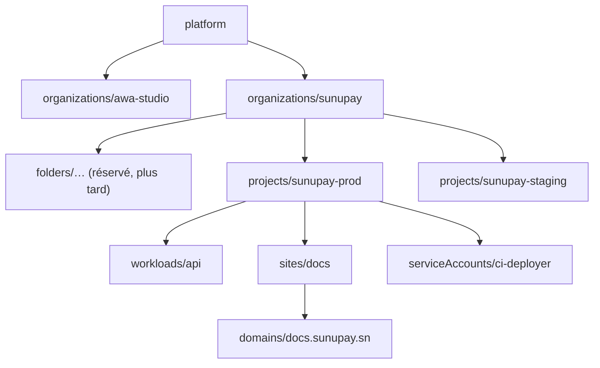

# IAM — identités, autorisations, clés

> **Statut : validé le 2026-10-29** (toutes les décisions de la section 16). Implémentation en cours, phase A.
>
> | Étape phase A | État |
> |---|---|
> | A1 — moteur `internal/iam` : catalogue, rôles prédéfinis, noms, principals, conditions d'expiration, `Check`/`TestPermissions`, cache | fait |
> | A2 — migration 000003 : organisations (personnelle par utilisateur), `iam_policies`, `iam_bindings`, reprise de `project_members` | fait |
> | A3 — routes : accès déclaré obligatoire, `security.Require`, routes publiques dérivées, realtime sur l'IAM, synchronisation Redis | fait |
> | A4 — API `GET/POST /iam/policy` (etag), `POST /iam/testPermissions`, `GET /iam/roles`, `GET /iam/permissions` | fait |
> | A5 — comptes de service, clés API v2 (`btr_live_`, HMAC + pepper, restrictions, actAs requis) — migration 000004 | fait |
> | A6 — journal d'audit immuable (`GET /iam/auditLogs`) — migration 000005 | fait |
> | A7 — accès staff : `iam.platform_admins` / `platform_support` réconciliés, fin du contournement `SUPER_ADMIN` | fait |
> | A8 — membres = bindings, suppression de `project_members` — migration 000006 | fait |
> | A9 — clés legacy `km_…` rattachées à des comptes de service `legacy-…` (même rôle, limitées à leur projet, échéance 90 jours), `POST /users/api-keys` → 410, RBAC legacy via `setIamPolicy`, tables `roles`/`permissions` supprimées — migration 000007 | fait |
>
> **Phase A terminée**, clés de cluster comprises (§7.4, migration 000008). **Phase B en cours** : STS et clés de SA asymétriques faits (§7.3, migration 000009) ; groupes, rôles personnalisés (B2), MFA/step-up et iam.requireMfa (B3), fédération OIDC, flux device et identité des workloads faits. **Phase B terminée.**
>
> Écart assumé avec §14 : gin ne permet pas `/{resource}:getIamPolicy` (nom de ressource avec des `/`). Les endpoints sont `GET /iam/policy?resource=…` et `POST /iam/policy {resource, policy}`, même contrat.

## 1. Ce qu'on veut, ce qu'on ne fait pas

**Objectifs**

1. **Une seule question, un seul endroit** : « le principal P a-t-il la permission X sur la ressource R ? ». Tout le code passe par `iam.Check(P, X, R)`. Aucun handler ne raisonne sur des rôles.
2. **Refus par défaut** : une route sans permission déclarée ne démarre pas (test bloquant).
3. **Moindre privilège** : permissions fines, rôles composables, clés restreintes, jetons courts.
4. **Machines de première classe** : comptes de service, fédération OIDC (CI sans secret), clés asymétriques.
5. **Tout est audité** : chaque décision sensible et chaque changement de droits laisse une trace consultable par le client.
6. **Stable dans le temps** : noms de ressources, format des permissions et API IAM figés dès la v1. Ce qui viendra plus tard (groupes, conditions, deny) a déjà sa place dans le modèle.

**Hors périmètre de ce document** : facturation (seulement le point d'accroche), quotas, réseau (VPC, firewall), chiffrement des données client.

## 2. État actuel et écarts

| Aujourd'hui | Problème | Cible |
|---|---|---|
| Pas d'organisation : un projet appartient à un user | Impossible d'avoir une équipe, une facturation commune, des règles communes | Hiérarchie **Organisation → Projet → Ressource** |
| RBAC projet : `project_members` + 3 rôles (OWNER, DEVELOPER, VIEWER) seedés en DB | Rôles figés, seed qui dérive, pas de rôle par service | Rôles prédéfinis **dans le code**, rôles personnalisés en DB |
| Permissions `project:view`, `k8s:workload:create`… | Grain trop gros (create = start/stop/rollback/déploiement de site) | `service.ressource.verbe` (§5) |
| Garde posé à la main par route (`RequireProjectPermissionFor`) | Une route oubliée = faille (déjà arrivé : `/rbac/assign-role`) | Chaque route **déclare** sa permission, test bloquant |
| `SUPER_ADMIN` / `ADMIN` Keycloak = contournement total | Pouvoir illimité, invisible, non audité | Accès staff explicite, justifié, audité (§10) |
| Clé API = l'utilisateur, avec tous ses droits ; scopes non appliqués | Une clé fuitée = compte entier compromis | Clés rattachées à un **compte de service**, droits ⊆ ses rôles, restrictions (§8) |
| Hash des clés en SHA-256 nu | Correct pour l'entropie actuelle, mais pas de « pepper » serveur | HMAC-SHA256 avec pepper (§8.3) |
| Clés de cluster (watcher) = API key `kind=cluster` | ✅ Fait | Compte de service système par cluster (§7.4) |
| Login humain : Keycloak, ROPC + PKCE | Pas de MFA imposable, pas de SSO par client | MFA par politique d'organisation, SSO par organisation (§9) |
| Audit : logs applicatifs échantillonnés | Non consultable par le client, non immuable | Journal d'audit dédié, immuable (§11) |

## 3. Hiérarchie de ressources



- **Organisation** : racine de tout ce qu'un client possède. Porte la facturation, les politiques (MFA obligatoire, durée de vie max des clés…) et les administrateurs. **Chaque inscription crée une organisation personnelle** : on n'aura jamais de projet « sans organisation » à migrer (erreur historique de GCP).
- **Dossier** : réservé dans le modèle (un niveau optionnel entre organisation et projet), non exposé en v1.
- **Projet** : frontière d'isolation (namespace K8s, quotas, ressources).
- **Ressources** : workloads, sites, domaines, comptes de service, clés…

### 3.1 Noms de ressources

Chaque ressource a un **nom canonique** stable, utilisé partout (API, policies, audit) :

```
organizations/{org}
organizations/{org}/projects/{project}            (forme longue)
projects/{project}                                (forme courte, le projet est unique globalement)
projects/{project}/workloads/{workload}
projects/{project}/sites/{site}/domains/{domain}
projects/{project}/serviceAccounts/{sa}/keys/{key}
```

- `{…}` = **UUID** interne, immuable. Les noms lisibles (`sunupay-prod`) sont des attributs modifiables, jamais des identifiants.
- L'ascendance (projet → organisation) est stockée et mise en cache : la vérification d'une permission sur `projects/X/sites/Y` remonte `projects/X` puis `organizations/O` puis `platform`.

## 4. Principals

| Principal | Format | Usage |
|---|---|---|
| Utilisateur | `user:{uuid}` | Humain authentifié par Keycloak |
| Compte de service | `serviceAccount:{uuid}` | Machine : CI, script, workload, intégration |
| Groupe | `group:{uuid}` | Ensemble d'utilisateurs et de comptes de service géré dans une organisation (phase B) |
| Tous les authentifiés | `allAuthenticatedUsers` | Réservé (partage public d'une ressource) |
| Tout le monde | `allUsers` | Réservé (ex. un artefact public) |

Le contexte d'une requête authentifiée porte **toujours** un principal unique, plus le moyen d'authentification (session web, jeton de compte de service, clé API, fédération) pour l'audit.

## 5. Permissions

Format : **`<service>.<ressource>.<verbe>`**, en anglais, figé.

```
resourcemanager.organizations.get       resourcemanager.projects.create
resourcemanager.projects.get            resourcemanager.projects.delete
resourcemanager.projects.getIamPolicy   resourcemanager.projects.setIamPolicy
resourcemanager.projects.undelete

workloads.workloads.list     workloads.workloads.get      workloads.workloads.create
workloads.workloads.update   workloads.workloads.delete   workloads.workloads.restart
workloads.workloads.rollback workloads.logs.read          workloads.metrics.read

sites.sites.list   sites.sites.get   sites.sites.create   sites.sites.update   sites.sites.delete
sites.deployments.create   sites.deployments.activate
sites.domains.create   sites.domains.verify   sites.domains.delete

iam.serviceAccounts.create   iam.serviceAccounts.delete   iam.serviceAccounts.actAs
iam.serviceAccountKeys.create   iam.serviceAccountKeys.delete
iam.apiKeys.create   iam.apiKeys.list   iam.apiKeys.delete
iam.roles.create   iam.roles.update   iam.roles.delete

billing.accounts.get   billing.accounts.update   billing.payments.create
logging.auditLogs.read
```

Familles ajoutées depuis (liste complète et titres dans le catalogue) :

```
workloads.variables.*   workloads.domains.*   workloads.builds.*   workloads.github.manage/read
workloads.registries.*
databases.databases.list/get/create/delete/connect/import/reset
iam.groups.*
platform.clusters.*   platform.clusterKeys.*   platform.projects.setLimits
```

- Le **catalogue** est un fichier Go unique (`internal/iam/permissions.go`), source de vérité, exporté pour la doc et l'UI.
- **Chaque route déclare une permission** (`.Permission(iam.SitesDeploymentsCreate, resolver)`). Un test parcourt toutes les routes enregistrées et échoue si l'une n'en a pas (exceptions explicites et listées : login, health, edge…).
- Une permission n'est **jamais supprimée** ni renommée une fois publiée (les rôles personnalisés des clients la référencent). Elle peut être dépréciée.

## 6. Rôles et policies

### 6.1 Rôles

Un rôle est un ensemble nommé de permissions.

- **Rôles de base** : `roles/owner`, `roles/editor`, `roles/viewer`. Pratiques mais larges.
- **Rôles prédéfinis par service** (à privilégier) : `roles/workloads.developer`, `roles/workloads.viewer`, `roles/sites.admin`, `roles/sites.deployer`, `roles/iam.serviceAccountUser`, `roles/iam.securityAdmin`, `roles/billing.admin`, `roles/logging.viewer`…
- Les rôles prédéfinis sont **définis dans le code** (versionnés avec lui, pas de seed qui dérive). Ajouter une permission à un rôle prédéfini se fait par une release.
- **Rôles personnalisés** (phase B) : définis par un client au niveau organisation ou projet, stockés en DB, limités aux permissions marquées « utilisables en rôle personnalisé ».

### 6.2 Policies d'autorisation

Une **policy** est attachée à une ressource (organisation, projet, ou ressource individuelle) :

```json
{
  "version": 1,
  "etag": "BwX8f2…",
  "bindings": [
    { "role": "roles/owner", "members": ["user:9b1…"] },
    { "role": "roles/sites.deployer", "members": ["serviceAccount:4c2…"] },
    {
      "role": "roles/workloads.developer",
      "members": ["user:a71…"],
      "condition": { "title": "accès temporaire", "expression": "request.time < timestamp('2027-01-01T00:00:00Z')" }
    }
  ]
}
```

- **Héritage** : les droits effectifs sur R sont l'union des bindings de R et de tous ses ancêtres. Un `roles/editor` sur l'organisation vaut sur tous ses projets.
- **Concurrence** : `setIamPolicy` exige l'`etag` lu par `getIamPolicy` (read-modify-write). Deux admins qui modifient en même temps : le second reçoit 409 au lieu d'écraser le premier.
- **Conditions** : champ réservé dès la v1 dans le schéma. En phase B, on n'accepte que des expressions d'expiration (`request.time < …`). Le langage complet (CEL) pourra venir plus tard sans changer le format.
- **Policies de refus** (deny, phase C, **fait**, migration 000042) : bloquent une permission quel que soit l'héritage (ex. « personne ne supprime un projet de prod sans passer par le groupe SRE »). Voir §6.4.

### 6.4 Politiques de refus (fait)

- **Où** : sur une organisation ou un projet (`/organizations/:id/denyPolicies`, `/projects/:id/denyPolicies`) ; valables pour la ressource et toutes ses descendantes. 50 au plus par ressource.
- **Contenu** : nom, description, **permissions refusées** (exactes, ou motifs `service.*`, `service.ressource.*`, `*` ; jamais une permission `platform.*`), **à qui** (`user:<id ou e-mail>`, `serviceAccount:<id>`, `group:<id>` de l'organisation, `allUsers`), **exceptions** (même format), condition d'expiration facultative (même format que les bindings).
- **Évaluation** (`Engine.check`) : les rôles décident d'abord ; une autorisation venue d'une ressource client est ensuite retirée si une politique de la chaîne (projet, organisation) la refuse au principal, à un de ses groupes, ou à `allUsers`/`allAuthenticatedUsers`, et qu'aucune exception ne le couvre. **Un refus l'emporte toujours.** Une autorisation accordée sur `platform` (staff) n'est pas concernée : l'organisation règle les droits de ses membres, pas ceux de l'exploitant (§10).
- **Réponse** : 403 `PERMISSION_DENIED` avec `deny_policy: {id, name, resource}` ; l'id de la politique va dans le journal d'audit (`metadata.deny_policy`). `testIamPermissions` en tient compte : la console grise les actions refusées.
- **Cache** : politiques par ressource, même TTL que les bindings ; une écriture diffuse une invalidation globale (Redis, comme les bindings) ; un refus n'est jamais prononcé sur le cache (règle de fraîcheur).
- **Échec fermé** : condition illisible ⇒ politique active ; ligne illisible ⇒ tout refusé à tous, **sauf** `iam.denyPolicies.*` (pour pouvoir la corriger).
- **Garde-fou** : une écriture est refusée (409 `FAILED_PRECONDITION`) si plus aucun propriétaire de l'organisation (`roles/owner` direct ou par un groupe) ne garderait `iam.denyPolicies.update`, sur l'organisation ou sur un de ses projets portant une politique. Toutes les politiques de l'organisation et de ses projets sont jugées ensemble, sous verrou de l'organisation. Supprimer une politique ne peut verrouiller personne.
- **Droits** : `iam.denyPolicies.list` (lecteurs et au-delà : savoir pourquoi une action est refusée) ; `iam.denyPolicies.update` (propriétaire, `roles/iam.securityAdmin`), **sensible** (step-up). Écritures avec `etag` (409 `ABORTED` si périmé). Supprimer un projet supprime ses politiques.
- **Listes filtrées** (« mes projets », `Holdings`) : mêmes refus que `Check`, relus sans cache. Organisation refusée : retirée avec ses projets ; projet refusé (par lui-même ou son organisation) : retiré, ou exclu de la liste de son organisation (`Holdings.Excluded`).

### 6.3 Correspondance avec l'existant

| Aujourd'hui | Devient |
|---|---|
| `project_members` OWNER | binding `roles/owner` sur le projet |
| DEVELOPER | `roles/editor` sans suppression de projet → nouveau rôle prédéfini `roles/developer` |
| VIEWER | `roles/viewer` |
| `project:members:manage` | `resourcemanager.projects.setIamPolicy` |

## 7. Comptes de service

Un compte de service (SA) est une identité machine **appartenant à un projet** : `projects/{p}/serviceAccounts/{sa}`, affichée `ci-deployer@sunupay-prod.iam.betorun.app`.

### 7.1 Ce qu'on peut faire avec un SA

- Lui donner des rôles comme à un utilisateur (sur son projet ou ailleurs).
- **L'utiliser** demande la permission `iam.serviceAccounts.actAs` sur lui. Sans ça, un développeur pourrait déployer un workload tournant sous un SA plus puissant que lui (escalade de privilège classique).

### 7.2 S'authentifier comme SA, du plus sûr au moins sûr

1. **Workloads betorun** (phase B) : un workload déclaré « exécuté comme SA X » reçoit automatiquement un jeton court monté dans le pod (projected token Kubernetes, échangé auprès de notre STS). **Aucune clé à gérer.**
2. **Fédération OIDC** (phase B, prioritaire pour l'Afrique dev = GitHub Actions/GitLab CI) : la CI présente son jeton OIDC (GitHub, GitLab) au STS betorun. Si une règle de fédération l'autorise (`repo:sunupay/api:ref:refs/heads/main` → SA `ci-deployer`), elle reçoit un jeton de 15 min. **Aucun secret stocké dans la CI.**
3. **Clés de SA asymétriques** : le client garde une clé privée (fichier JSON), signe une assertion JWT et l'échange contre un jeton court (RFC 7523, grant `jwt-bearer`). betorun ne stocke que la clé publique.
4. **Clé API** (§8) : secret simple, pour les cas où rien d'autre n'est possible.

**Fait** :

- **Fédération OIDC.** `internal/iam/federation.go`, `internal/iam/sts/federation.go`, migration 000012.
  - *Relations de confiance par compte* (`/projects/{p}/serviceAccounts/{sa}/federation`) : émetteur https, motif de sujet (exact ou `préfixe*`), claims exigés. actAs requis, création sensible.
  - *Émetteurs publics* : pour GitHub et gitlab.com, le motif doit fixer le propriétaire.
  - *Échange* : `token-exchange` (RFC 8693). Seuls les émetteurs d'une relation existante sont contactés, jamais une adresse privée (SSRF). `aud` doit valoir l'émetteur du STS, le `jti` est à usage unique. Le jeton émis dure 15 min et est lié à la relation.
- **Identité des workloads.** `internal/iam/sts/workloads.go`, migration 000013.
  - *Déploiement* : `service_account` à la création du workload (actAs requis). Le chart `standard-app` monte un jeton Kubernetes projeté (audience = STS) et pose `BETORUN_TOKEN_FILE` et `BETORUN_STS_TOKEN_URI`.
  - *Clés du cluster* : le watcher publie l'émetteur et le JWKS des jetons de son cluster, car l'apiserver n'est pas joignable depuis l'extérieur.
  - *Échange* : `system:serviceaccount:<ns>:<release>` → workload → compte de service. Le jeton est lié au workload. Activé par `kubernetes.cluster_id`.
- **CLI.** Flux device (RFC 8628) porté par le backend : le code est validé dans la console, la CLI reçoit une session betorun (`POST /identity/device/code`, `/identity/device/token`). Keycloak n'intervient pas.

### 7.3 STS : qui émet les jetons machine

| Option | Pour | Contre |
|---|---|---|
| **A. STS betorun** (recommandé) : endpoint `/iam/v1/token`, jetons signés par une clé betorun, publiée en JWKS ; le middleware accepte deux émetteurs (Keycloak pour les humains, STS pour les machines) | Pas de limite d'échelle Keycloak, contrôle total des claims et de la durée, fédération OIDC facile | Un composant de sécurité à opérer : rotation des clés de signature, HSM/KMS en prod |
| B. Un client Keycloak par SA (auth `private_key_jwt`) | Rien à coder pour l'émission | Des milliers à millions de clients Keycloak (problèmes de perf connus), fédération OIDC moins souple, couplage fort |

**Fait (B1)** — `internal/iam/sts`, migration 000009 :

- Émetteur : `iam.sts_issuer` = `<API publique>/kmanager/v1/iam` (le contrat §14 `/iam/v1/token` est servi sous le préfixe de l'API). Endpoint `POST <issuer>/token`, `GET <issuer>/.well-known/jwks.json`, `GET <issuer>/.well-known/openid-configuration`. Publics : la preuve est dans la requête.
- Jetons : JWT ES256, `typ: at+jwt`, `iss` = émetteur, `aud` = `betorun-api`, `sub` = `serviceAccount:<uuid>`, 1 h au plus (jamais au-delà de la validité de la clé), claims `btr_auth` (méthode) et `btr_key` (clé utilisée). L'API les vérifie localement ; compte désactivé/supprimé ou clé désactivée/échue ⇒ refus sous 30 s.
- Clés de signature : en base, chiffrées AES-256-GCM par une KEK hors base (`iam.sts_key_encryption_key`, 32 octets base64 ; à remplacer par un KMS : seul `keys.go` connaît le stockage). Rotation automatique tous les 30 jours ; la suivante est publiée 24 h avant de signer ; l'ancienne reste publiée jusqu'à l'expiration de ses derniers jetons. Verrou consultatif Postgres entre réplicas.
- Grant `jwt-bearer` (RFC 7523) : en-tête `kid` = clé de SA, `alg` = celui de la clé ; `iss` = `sub` = principal du compte ; `aud` = endpoint ; `iat`/`exp` (≤ 1 h d'écart) et `jti` obligatoires ; un `jti` ne sert qu'une fois (table `iam_assertion_jti`). Erreurs au format RFC 6749. Émissions et refus journalisés au nom du compte.
- Clés de SA (`/projects/{p}/serviceAccounts/{sa}/keys`) : générées (ES256, fichier de clé JSON remis une fois) ou clé publique importée (ES256, RS256 ≥ 2048) ; 90 jours par défaut, 365 au plus ; 10 valides par compte ; actAs requis.
- Watcher : clé de cluster `type: key_file` ; le watcher (`--key-file`) obtient ses jetons auprès du STS, plus aucun secret longue durée sur le réseau. Rotation avec changement de type pour migrer depuis une clé API.

### 7.4 Comptes de service système

Les composants de la plateforme ont leurs propres SA, sans clé longue durée : un SA par cluster pour le watcher (remplace les clés `kind=cluster`), un pour le worker Temporal, un pour l'edge. Le staff betorun n'a jamais besoin de leurs secrets.

**Fait pour les clusters** (`internal/iam/clusteragents.go`, migration 000008) :

- Un compte `cluster-agent` par cluster, rattaché à la plateforme (pas à un projet ; `service_accounts.project_id` XOR `cluster_id`), avec `roles/platform.clusterAgent` (seule permission : `platform.clusters.report`) sur `platform`.
- Garde des routes du watcher (`ClusterAgent(ref)`) : l'appelant doit être **le compte du cluster visé** (`:clusterID` ou `cluster_id` du corps) **et** avoir la permission. Avant : n'importe quelle clé de cluster pouvait parler au nom de n'importe quel cluster.
- Clés v2 `btr_live_…` restreintes à `platform.clusters.report`, 90 jours au plus. API staff : `POST/GET /admin/cluster-keys`, `POST /admin/cluster-keys/{keyID}/rotate` (`grace_days` 0–30, défaut 7, ou `immediate`), `DELETE /admin/cluster-keys/{keyID}`.
- Migration : les clés `km_…` de cluster sont rattachées au compte de leur cluster et expirent sous 90 jours ; celles **sans `cluster_id` sont révoquées** (sans compte, elles agissaient comme l'administrateur qui les avait créées, sur toute l'API).
- `ReconcilePlatformRoles` refuse `roles/platform.clusterAgent` (sinon la réconciliation effacerait les comptes système).
- Phase B : clés asymétriques + STS pour supprimer le secret longue durée du watcher ; comptes système du worker Temporal et de l'edge.

## 8. Clés API

### 8.1 Rôle

Une clé API est un **secret simple** pour les scripts et intégrations qui ne peuvent pas faire mieux. Elle est **toujours rattachée à un compte de service**, jamais à un humain :

- quand quelqu'un quitte l'équipe, ses scripts ne cassent pas et ne gardent pas ses droits personnels ;
- les droits d'une clé = ceux du SA, **intersectés** avec les restrictions de la clé.

Pour la CLI des humains, pas de clé : **flux « device authorization »** (`betorun login` affiche un code, on valide dans le navigateur, avec MFA). Keycloak le supporte nativement.

### 8.2 Restrictions d'une clé

- **Permissions** : sous-ensemble explicite (ex. seulement `sites.deployments.create`).
- **Ressources** : limitée à certaines ressources (ex. un seul site).
- **Réseau** : plages IP autorisées (CIDR).
- **Durée** : expiration obligatoire. Le maximum est fixé par une politique d'organisation, 90 jours par défaut ; « jamais » est interdit sauf si l'organisation l'autorise explicitement.

### 8.3 Format et stockage

```
btr_live_k7f3q9xz2m_8Hq2…(40 caractères)…_c3a1
└┬┘ └┬─┘ └───┬────┘ └──────────┬──────────┘ └─┬┘
 │   │      │                  │              └ checksum CRC32 (détection de faute de frappe hors ligne)
 │   │      │                  └ secret aléatoire 240 bits, base62
 │   │      └ identifiant public de la clé (lookup en O(1), affichable, journalisé)
 │   └ environnement : live | test
 └ préfixe produit : permet l'inscription au secret scanning de GitHub
```

- Stockage : **HMAC-SHA256(pepper, secret)**. Le pepper est un secret serveur (KMS/Vault) jamais en base, donc une fuite de la base ne permet pas de tester des clés. Comparaison en temps constant.
- Le secret n'est **affiché qu'une fois**. On garde : identifiant, nom, créateur, dates, dernière utilisation (IP, user agent), compteur.
- **Rotation sans coupure** : une nouvelle clé coexiste avec l'ancienne pendant une période de grâce, puis l'ancienne expire. C'est le mécanisme déjà fait pour les clés de cluster, généralisé.
- **Détection de fuite** : partenariat GitHub secret scanning (rendu possible par le préfixe) ; une clé signalée est révoquée automatiquement et l'organisation est notifiée.

### 8.4 Migration

Les clés existantes (`km_…`, rattachées à des utilisateurs) restent valides pendant une période de transition. Pour chaque utilisateur qui en a, on crée un SA « `legacy-<user>` » avec ses droits actuels et on rattache ses clés. Plus aucune nouvelle clé utilisateur n'est émise.

## 9. Authentification des humains

- **Keycloak reste le fournisseur d'identité** des humains (cf. [ADR-0005](../adr/0005-keycloak-source-of-truth.md)) : Authorization Code + PKCE (en place), Google/GitHub, flux device pour la CLI.
- **SSO par organisation** : porté par le backend (OpenID Connect), et non par Keycloak Organizations. Le client branche son Entra ID, son Google Workspace, son Okta ou son Keycloak sans que Keycloak apparaisse (§9.2).
- **MFA** : TOTP et WebAuthn/passkeys. Une politique d'organisation peut l'**imposer** ; obligatoire pour tout détenteur de `setIamPolicy` sur une organisation.
- **Ré-authentification pour les actions sensibles** (*step-up*) : supprimer un projet, créer une clé, modifier une policy d'organisation exigent une authentification récente (`auth_time` < 10 min), sinon l'UI redemande le mot de passe ou la passkey.
- **Jetons** : accès 10 min, refresh avec rotation et détection de réutilisation (un refresh rejoué révoque toute la session), sessions listables et révocables par l'utilisateur et par les admins de l'organisation.

### 9.1 MFA et step-up : fait (B3)

`internal/middleware/security/mfa.go`, `internal/iam/orgpolicy.go`, migration 000011.

- **Signal** : claims Keycloak `acr` (niveau atteint) et `auth_time`. `iam.mfa_acr_values` liste les valeurs qui attestent un MFA (ex. `gold`). Vide : rien n'est exigé et une organisation ne peut pas imposer le MFA (`FAILED_PRECONDITION`).
- **Step-up** : 21 permissions marquées `Sensitive` (policies, suppression de projet, clés, rôles personnalisés, groupes, facturation, clés de cluster, suppression, import et remise à zéro d'une base, limites d'un projet) exigent un MFA de moins de `iam.step_up_max_age` (10 min). Seules les personnes sont concernées (jeton Keycloak). Les comptes de service, clés API et jetons STS ne le sont pas.
- **`iam.requireMfa`** : politique d'organisation (`GET/PUT /organizations/{id}/securityPolicy`). Toute action d'une personne sur l'organisation ou ses projets exige un MFA, sans contrainte de fraîcheur. La modifier est sensible, donc personne ne l'active sans être en MFA. Prise d'effet en 30 s au plus sur les autres réplicas.
- **Refus** : RFC 9470. Réponse 401, `WWW-Authenticate: Bearer error="insufficient_user_authentication", acr_values="gold"[, max_age=600]`, corps `code: STEP_UP_REQUIRED`. La console relance la connexion avec `GET /identity/oidc/authorize?step_up=true` (`acr_values` + `max_age=0`, ré-authentification forcée), puis l'utilisateur refait l'action.
- **Console** : `GET /iam/session` indique l'état MFA de la session, la validité du step-up et le lien vers la page Sécurité du compte Keycloak (gestion TOTP/passkeys).
- **Limite connue** : le login direct email/mot de passe (`POST /identity/login`, ROPC) ne produit pas de session MFA. Ces sessions ne passent ni le step-up ni `iam.requireMfa`. À retirer (OAuth 2.1).

**Configuration du realm Keycloak (prod)**, à faire avant d'activer `mfaAcrValues` :

1. *Realm settings → General → ACR to LoA mapping* : `silver` → 1, `gold` → 2.
2. *Authentication* : dupliquer le flow `browser` et y créer deux sous-flows *Conditional*, chacun avec une condition *Level of authentication* :
   - LoA 1 : formulaire identifiant/mot de passe ;
   - LoA 2 : *OTP Form* et/ou *WebAuthn Passwordless*, en *Required*. Un utilisateur sans facteur est alors invité à en enregistrer un.

   Lier ce flow comme *Browser flow* du realm.
3. *Required actions* : activer *Configure OTP* et *WebAuthn Register Passwordless*.
4. Vérifier que le scope client `acr` est dans les *default client scopes* du client web : le claim `acr` est alors présent dans le jeton d'accès.

### 9.2 Connexion d'entreprise (SSO OpenID Connect) : fait (C, 2026-11-20)

`internal/auth/sso/`, `internal/modules/identity/service/ssoflow.go`, `internal/modules/iamapi/sso.go`, migration 000055.

- **Configuration** (`GET/PUT/DELETE /organizations/{id}/sso`, lecture `resourcemanager.organizations.get`, écriture `…update`) :
  - émetteur et client ;
  - le secret est chiffré (donnée associée `org-sso:<org>`) et n'est jamais relu ;
  - options proposer et imposer ;
  - rôle donné à la première connexion : aucun, `roles/viewer` ou `roles/editor`.
  
  L'activation vérifie la découverte. Changer d'émetteur ou de client remet le test à zéro.
- **Domaines** :
  - un domaine est prouvé par l'enregistrement TXT `_betorun-sso.<domaine>` = `betorun-sso=<jeton>` ;
  - un domaine vérifié appartient à une seule organisation (index unique partiel) ;
  - le dernier domaine ne peut pas être retiré tant que le SSO est imposé.
- **Connexion** :
  - `POST /identity/login/sso {email}` désigne l'organisation par le domaine de l'adresse et renvoie la page du fournisseur (PKCE, nonce, `login_hint`, état dans Redis pour 10 min, à usage unique) ;
  - au retour, `POST /identity/login/sso/callback` échange le code et vérifie l'`id_token` : signature JWKS, `iss`, `aud`, `exp`, `iat`, nonce, `email_verified` et domaine vérifié ;
  - le compte betorun est retrouvé ou créé (identité `sso:<org>`), le rôle de première connexion est attribué, puis une session betorun est ouverte avec `amr=["sso"]`, et le second facteur reste exigé si le compte en a un.
- **Imposer** : refusé tant qu'aucun domaine n'est vérifié et qu'aucune connexion n'a réussi avec ce fournisseur. Une fois le SSO imposé, le mot de passe, Google, GitHub et la passkey sont refusés pour ces adresses (403 `SSO_REQUIRED`). Un mauvais mot de passe garde la réponse ordinaire, ce qui ne révèle rien.
- **Sécurité réseau** : le client HTTP refuse les adresses privées (SSRF) et ne suit aucune redirection. `sso.allow_insecure_issuers` (http, loopback) existe pour le dev uniquement.
- **Console** :
  - bouton « Connexion d'entreprise (SSO) » sur l'écran de connexion, proposé aussi sur `SSO_REQUIRED` ;
  - page de retour `/auth/sso/callback` ;
  - section Paramètres → Connexion d'entreprise : fournisseur, adresse de retour à copier, domaines avec leur TXT et le bouton « Vérifier ».
- **Plus tard** : SAML (pour les clients qui n'ont pas d'OIDC) et SCIM (provisionnement et déprovisionnement automatiques).

## 10. Accès du staff betorun

Les rôles Keycloak `SUPER_ADMIN`/`ADMIN` ne donnent plus de contournement global :

- Le staff a des **rôles plateforme** explicites sur la ressource `platform` (`roles/platform.support` : lecture de la flotte et tickets de support, `roles/platform.admin`), vérifiés par le même `iam.Check`. Ils sont attribués par la configuration (`iam.platform_admins`, `iam.platform_support` : listes d'e-mails), réconciliée toutes les 10 min ; un e-mail retiré perd son rôle.
- `roles/platform.admin` porte les clés de cluster et `platform.projects.setLimits` : `PATCH /admin/projects/{id}/limits` (CPU, mémoire, stockage ; sensible). Un client ne choisit pas ses limites : un projet naît avec les valeurs par défaut, seul le staff les change.
- Accéder aux données d'un client exige une **justification** (ticket) et produit une entrée d'audit **visible par le client** (équivalent « Access Transparency » de Google).
- **Accès d'assistance** (fait, [ADR 0017](../adr/0017-acces-assistance.md), [module](../modules/assistance.md)) : pour agir chez un client, une personne nommée reçoit une liaison temporaire `roles/support.assistant` sur l'organisation (rôle réservé, lecture et actions réversibles). Le client accorde depuis un ticket (4 h par défaut, 24 h au plus), refuse ou retire d'un clic. Ses politiques de refus s'appliquent.
- Accès d'urgence (*break-glass*) : même mécanisme, sans l'accord du client, 1 h au plus ; administrateurs seulement, double authentification, propriétaires prévenus immédiatement.

**Fait (C, 2026-11-20).** `router.Access.Staff(target)` et `security.StaffAccess` couvrent les routes staff qui touchent un client :
- limites d'un projet et d'une organisation ;
- modules complémentaires ;
- facturation d'une organisation.

Sur ces routes, l'en-tête `X-Betorun-Justification` est obligatoire : il est encodé en URL et fait de 10 à 300 caractères. Sans lui, la réponse est 400 `JUSTIFICATION_REQUIRED`, même pour une lecture. L'entrée d'audit est rangée sous la ressource du **client** avec `staff_access`, la justification et la permission plateforme utilisée. La page Audit du client l'affiche « Équipe betorun » avec le motif, et propose un filtre dédié. La console staff demande le motif une fois par client et par onglet.

## 11. Journal d'audit

- **Activité d'administration** (toujours activée, non désactivable) : tout changement de policy, de SA, de clé, de projet, d'organisation, tout accès staff.
- **Accès aux données** (activable par organisation, **fait** en C le 2026-11-20) : contrainte `logging.dataAccessLogs`.
  - Routes marquées `Access.DataRead()` : variables d'un workload, logs d'un workload, logs de build.
  - Leurs lectures sont journalisées avec `data_access=true` quand l'organisation l'a activé.
  - Les lectures du staff le sont toujours.
- Chaque entrée : horodatage, principal, mode d'authentification (session, SA, clé API `k7f3q9xz2m`, fédération), permission, ressource, décision (autorisé/refusé), IP, user agent, trace ID.
- **Immuable** : table append-only (aucun `UPDATE`/`DELETE` accordé au rôle applicatif), partitionnée par mois, exportée vers le stockage objet en verrouillage WORM. Rétention : 400 jours pour l'administration.
- Consultable par les clients avec `logging.auditLogs.read` (API + écran console). Page Audit : journal du projet (avec les actions d'organisation qui le touchent) et, pour qui a ce droit sur l'organisation (propriétaires par défaut), journal de l'organisation.

## 12. Point de décision unique

```go
// internal/iam
type Decision struct {
    Allowed bool
    Reason  string // "binding roles/editor on organizations/…", "no binding", "denied by …"
}

func (e *Engine) Check(ctx context.Context, p Principal, perm Permission, resource Name) (Decision, error)
func (e *Engine) TestPermissions(ctx context.Context, p Principal, resource Name, perms []Permission) ([]Permission, error)
func (e *Engine) ListAccessible(ctx context.Context, p Principal, perm Permission, parent Name) ([]Name, error)
```

- **Middleware** : `Require(perm, resolver)`. C'est le `RequireProjectPermissionFor` actuel, généralisé (le resolver rend un nom de ressource au lieu d'un projet).
- **`TestPermissions`** est exposé en API (`POST …:testIamPermissions`) : la console l'utilise pour afficher ou masquer les boutons. Plus de logique de rôles dupliquée côté front.
- **`ListAccessible`** sert aux listes (« mes projets ») sans fuite.
- **Performance** : la décision se calcule depuis les bindings du principal (et de ses groupes) le long de l'ascendance. Un cache par principal (bindings + ascendances) est invalidé par un numéro de version de policy diffusé en Redis pub/sub. Cible : p99 < 2 ms en cache, < 15 ms hors cache.
- **Échec fermé** : si le moteur IAM ne peut pas décider (DB indisponible), la réponse est un refus (503), jamais un accès.

## 13. Modèle de données (esquisse)

```sql
organizations      (id, display_name, billing_account_id, created_at, deleted_at)
projects           (+ organization_id NOT NULL)                       -- existant, étendu
resource_ancestry  (resource_name PK, parent_name, organization_id)   -- pour remonter vite

iam_policies       (resource_name PK, version, etag, updated_at, updated_by)
iam_bindings       (id, resource_name, role, principal, condition JSONB, created_at, created_by)
                   -- index (principal), (resource_name)
iam_custom_roles   (name PK, parent_resource, title, permissions TEXT[], stage, deleted_at)
iam_groups         (id, organization_id, email, display_name)          -- phase B
iam_group_members  (group_id, principal)                               -- phase B
iam_deny_policies  (id, resource_name, display_name, denied_permissions, denied_principals, exception_principals, condition, etag…)  -- phase C, migration 000042

service_accounts       (id, project_id, account_id, display_name, disabled, created_at)
service_account_keys   (id, service_account_id, public_key_pem, algorithm, valid_after, valid_before, disabled)
workload_identity_pools (id, project_id, issuer, attribute_mapping JSONB, attribute_condition)
api_keys_v2            (id, public_id, service_account_id, hmac, restrictions JSONB,
                        expires_at, revoked_at, last_used_at, last_used_ip, created_by)

org_policies       (resource_name, constraint, enforced, list_values JSONB)  -- 000011 + 000054 :
                   --   iam.requireMfa, iam.allowedMemberDomains (liste), iam.disableServiceAccountKeyCreation, logging.dataAccessLogs
org_sso            (organization_id PK, issuer, client_id, secret_sealed, enabled, enforced, jit_role, tested_at…)  -- 000055
org_sso_domains    (organization_id, domain, token, verified_at)  -- domaine vérifié unique entre organisations
audit_log          (partitionné par mois, append-only)
```

## 14. API IAM (contrat public, figé en v1)

```
GET    /iam/v1/{resource}:getIamPolicy
POST   /iam/v1/{resource}:setIamPolicy        { policy, etag }
POST   /iam/v1/{resource}:testIamPermissions  { permissions: [...] }
GET    /iam/v1/roles                          rôles prédéfinis + personnalisés visibles
GET    /iam/v1/permissions                    catalogue

POST   /iam/v1/projects/{p}/serviceAccounts
POST   /iam/v1/projects/{p}/serviceAccounts/{sa}/keys
POST   /iam/v1/projects/{p}/serviceAccounts/{sa}/apiKeys
POST   /iam/v1/token                          STS : jwt-bearer, token-exchange (OIDC fédéré)
GET    /iam/v1/audit-logs?resource=…
```

Le nom `{resource}` est le nom canonique (§3.1), ce qui rend les endpoints de policy identiques pour toutes les ressources.

## 15. Phases

| Phase | Contenu | Pourquoi dans cet ordre |
|---|---|---|
| **A — fondations** (avant la facturation et le multi-projets) | Organisations (perso auto), noms de ressources, catalogue de permissions, rôles prédéfinis dans le code, `iam_bindings` + `iam.Check` + cache, déclaration obligatoire par route, API get/set/testIamPermissions, SA + clés API v2 restreintes, journal d'audit (administration), staff sans contournement | Tout le reste s'appuie dessus ; c'est ce qui coûterait cher à changer plus tard |
| **B — machines et équipes** | STS, fédération OIDC GitHub/GitLab, clés de SA asymétriques, identité des workloads, flux device pour la CLI, groupes, rôles personnalisés, conditions d'expiration, MFA imposable, step-up | Débloque la CI sans secret et les équipes |
| **C — entreprise** | Policies de refus (**fait**), politiques d'organisation étendues (**fait** : domaines des membres, clés de SA interdites, journal d'accès aux données), SSO OIDC par organisation (**fait**, §9.2), accès staff transparent côté client (**fait**, §10), journal d'accès aux données (**fait**, §11), dossiers (**reporté**, voir ci-dessous) | Clients régulés, gouvernements, banques |

**Dossiers reportés (décision du 2026-11-20).** Une organisation compte au plus 3 projets aujourd'hui : un niveau intermédiaire n'apporte rien tant que cette limite tient. Le modèle le réserve déjà (§3, `folders/…`). Il sera ajouté quand un client aura besoin de déléguer l'administration d'un groupe de projets (entité, pays, filiale). Le travail à prévoir :
- `resource_ancestry` à plusieurs niveaux ;
- l'héritage dans `iam.Check` ;
- le déplacement d'un projet (permission `resourcemanager.projects.move`) ;
- un écran.

Migration de l'existant pendant la phase A : création d'une organisation personnelle par utilisateur, rattachement de ses projets, conversion de `project_members` en bindings (§6.3), passage des routes sur `iam.Require`, clés utilisateur rattachées à un SA legacy (§8.4). `project_members` reste en lecture jusqu'à la bascule complète, puis est supprimée.

## 16. Décisions (validées le 2026-10-29)

1. **Organisation obligatoire**, créée automatiquement à l'inscription (organisation personnelle).
2. **Format des permissions** `service.ressource.verbe`, en anglais, figé (§5).
3. **Rôles prédéfinis dans le code**, personnalisés en DB (§6.1).
4. **STS betorun pour les jetons machine** (option A) ; Keycloak seulement pour les humains (§7.3).
5. **Clés API rattachées à un compte de service**, plus jamais à un humain ; CLI humaine par flux device (§8).
6. **Format de clé** `btr_live_…` avec checksum et stockage HMAC + pepper (§8.3).
7. **Fin du contournement `SUPER_ADMIN`** au profit de rôles plateforme audités (§10).
8. ~~Keycloak Organizations pour aligner organisations, invitations et SSO~~. **Remplacé le 2026-11-20** : SSO OIDC porté par le backend (§9.2), Keycloak reste invisible.
9. **Ordre des phases** A → B → C (§15), la phase A avant la facturation et le multi-projets.
