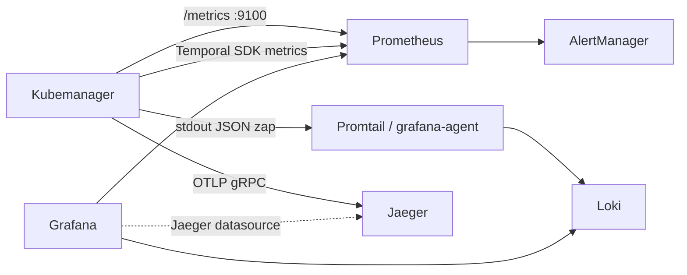

# Observabilité

> Les 3 piliers (logs / metrics / traces), comment ils se parlent via le trace ID, et où regarder quand ça va mal.

## Le "holy trinity"



Les 3 systèmes se **corrèlent via le `trace_id`** :
- Le trace_id est généré par OTEL gin middleware.
- Il est posé dans le gin context (`c.GetString("trace_id")`).
- Un logger scopé (`middleware.LoggerFrom(c, a.Logger)`) l'inclut dans chaque log zap.
- Il est envoyé à Jaeger comme ID racine.
- Loki a le champ `trace_id` labelisé (via le parser JSON du pipeline Promtail).
- Depuis Grafana, cliquer sur un log → ouvre la trace Jaeger associée.

## Logs

### Stack

- **Format** : JSON structuré via zap. Chaque log a `level`, `ts`, `msg`, `caller`, et des champs custom (`trace_id`, `workload_id`, `workflow_id`…).
- **Collecte** : Promtail lit les container logs Docker (`/var/lib/docker/containers/*/…`), parse le JSON, pousse vers Loki.
- **Query** : LogQL dans Grafana.

### Exemples LogQL utiles

```logql
# Toutes les erreurs des 10 dernières min
{job="kubemanager"} |~ "(?i)error|panic|failed" | json | level="error"

# Suivre une requête par trace_id
{job="kubemanager"} | json | trace_id="abc123..."

# Logs d'un workflow Temporal
{job="kubemanager"} | json | workflow_id=~"deploy-workload-.*"
```

### Règles sur les logs

- **JAMAIS** de log au niveau `Info` dans un hot path (boucle d'un handler, loop d'un watcher…). Met en `Debug` et log les agrégats à `Info` (ex: "processed 1234 events in 60s").
- **JAMAIS** de données sensibles : token, password, clé API complète, PII. Le logger zap peut redacter automatiquement si on lui passe des champs typés (à faire si besoin).
- **TOUJOURS** utiliser le logger scopé par requête via `middleware.LoggerFrom(c, s.Logger)` pour avoir le `trace_id` gratuit.

## Métriques

### Sources

| Source | Prefix | Exemples |
|--------|--------|----------|
| Gin HTTP | `gin_` | `gin_requests_total`, `gin_request_duration_seconds_bucket` |
| Runtime Go | `go_`, `process_` | `go_goroutines`, `go_memstats_heap_inuse_bytes` |
| GORM (OTEL) | `db_sql_` | `db_sql_latency`, `db_sql_calls` |
| Temporal | `temporal_` | `temporal_workflow_completed_total`, `temporal_workflow_task_schedule_to_start_latency_seconds` |
| Redis | `redis_` | `redis_hits_total`, `redis_latency` |
| Business custom | `kubemanager_` | `kubemanager_workload_status_transitions_total`, `kubemanager_cluster_last_seen_timestamp_seconds` |

### Exposition

- `/metrics` exposé sur un **port dédié** (`:9100` par défaut, configurable via `config.Metrics.ListenAddr`) — pas sur le port public 8080.
- En prod : NetworkPolicy "monitoring namespace → :9100" uniquement.
- En dev (docker-compose) : Prometheus scrape `kubemanager:8080` — l'app écoute sur les deux ports si `Metrics.ListenAddr` est set, sinon sur le port public par défaut.

### Cardinalité — contrat strict

Règle : **aucun label à cardinalité unbounded**. Bannis :

- `user_id`, `workload_id`, `project_id`, `request_id`, `trace_id`.

Autorisés :

- `status`, `phase`, `code`, `method`, `handler` (route template `/workloads/:id`, jamais le path brut).
- `cluster_id` (borné, < 1000 attendu).
- Enum finis (activity_type, workflow_type, …).

Voir [infrastructure/observability/business_metrics.go](../../internal/infrastructure/observability/business_metrics.go) pour notre contrat.

### PromQL utiles

```promql
# Error rate global (RED)
sum(rate(gin_requests_total{code=~"5.."}[5m])) / sum(rate(gin_requests_total[5m]))

# P95 latency par route
histogram_quantile(0.95, sum by (handler, le) (rate(gin_request_duration_seconds_bucket[5m])))

# Workload delete failures
sum(rate(kubemanager_workload_status_transitions_total{status="DELETE_FAILED"}[10m]))

# Clusters silencieux > 5 min
time() - kubemanager_cluster_last_seen_timestamp_seconds > 300

# Temporal task queue lag
max(temporal_workflow_task_schedule_to_start_latency_seconds)
```

## Traces (OpenTelemetry)

### Ce qu'on trace

- **Tout request HTTP** (otelgin middleware).
- **Toutes les queries SQL** (plugin otelgorm sur GORM).
- **Toutes les commandes Redis** (redisotel).
- **Tous les workflows et activities Temporal** (native OTEL dans le SDK Temporal).
- **Appels Keycloak admin REST** via le client HTTP instrumenté.

### Sampling

Configurable via `config.Tracing.SampleRatio` (env `KUBEMANAGER_TRACING_SAMPLE_RATIO`) :

- Dev : `1.0` (100% — on veut tout voir).
- Prod : `0.01` (1%) — échantillonnage suffisant pour détecter les problèmes, budget Jaeger soutenable.

Les erreurs (5xx) et les requêtes qui dépassent un seuil de latence (à câbler avec `ParentBased(AlwaysOnSampler)`) peuvent être systématiquement tracées — à activer si besoin.

### Propagation context

Obligatoire dans tout le code :

```go
// ❌ jamais ça
r.db.Create(workload)

// ✅ toujours ça
r.db.WithContext(ctx).Create(workload)
```

Le `ctx` transporte le span racine — sans lui, les sub-spans (SQL, Redis) sont orphelins et la trace est cassée.

## Dashboards Grafana

3 dashboards provisionnés dans `docker/grafana/provisioning/dashboards/` :

| Dashboard | Focus |
|-----------|-------|
| **Overview (RED)** | Request rate, error rate, latency P50/P95/P99, top endpoints, erreurs Loki |
| **Workloads** | Latence POST /workloads, rate limit 429, auth 401/403, logs lifecycle |
| **Infra runtime Go** | Goroutines, heap, GC pause, CPU, FDs |

En prod : remplacer par le chart kube-prometheus-stack (qui apporte aussi les dashboards Node Exporter, kubelet, etc.).

## Alertes (PrometheusRule)

Définies dans [chart/kubemanager-backend/templates/prometheusrule.yaml](../../chart/kubemanager-backend/templates/prometheusrule.yaml). Activé via `--set prometheusRule.enabled=true`.

| Alerte | Déclencheur |
|--------|-------------|
| `KubeManagerHighErrorRate` | 5xx > 1% pendant 5 min |
| `KubeManagerHighLatencyP95` | P95 > 1 s pendant 10 min |
| `KubeManagerRateLimitStorm` | > 5 429/s pendant 5 min |
| `TemporalWorkflowFailureRate` | > 5% de workflows failed pendant 10 min |
| `TemporalTaskQueueLag` | lag > 60 s pendant 10 min |
| `WorkloadSagaDeleteFailures` | transitions `DELETE_FAILED` détectées |
| `ClusterWatcherStale` | cluster silencieux > 5 min |
| `KubeManagerHighGoroutines` | > 10 000 goroutines pendant 15 min |
| `KubeManagerHeapPressure` | heap inuse / sys > 90% pendant 15 min |

Chaque alerte a une `runbook_url` qui pointe vers la section appropriée de [interne/runbook.md](../interne/runbook.md).

## Rétention

30 jours côté Prometheus + Loki (dev : disque local, prod : S3 pour Loki, remote_write vers Mimir pour Prometheus). Voir [interne/observability-retention.md](../interne/observability-retention.md).

## Checklist ajout d'une feature

Quand tu ajoutes un endpoint/service/activity, assure-toi que :

- [ ] Les logs importants sont émis via `middleware.LoggerFrom(c, s.Logger)` (trace_id inclus).
- [ ] Les erreurs métier sont typées (`betoerrors.New(code, msg)`) pour un bon mapping status HTTP.
- [ ] Si nouvelle business metric : nommée `kubemanager_<subsystem>_<name>`, label cardinality bornée, documentée dans `business_metrics.go`.
- [ ] Si nouveau workflow : apparaîtra automatiquement dans les métriques Temporal `temporal_workflow_*{workflow_type="..."}`.
- [ ] Si nouvelle query SQL coûteuse : span OTEL couvrira, mais ajouter un commentaire dans le repo si tu prévois de mettre un index.

## Prochaine lecture

- [Runbook oncall](../interne/runbook.md).
- [Rétention Prometheus/Loki](../interne/observability-retention.md).
