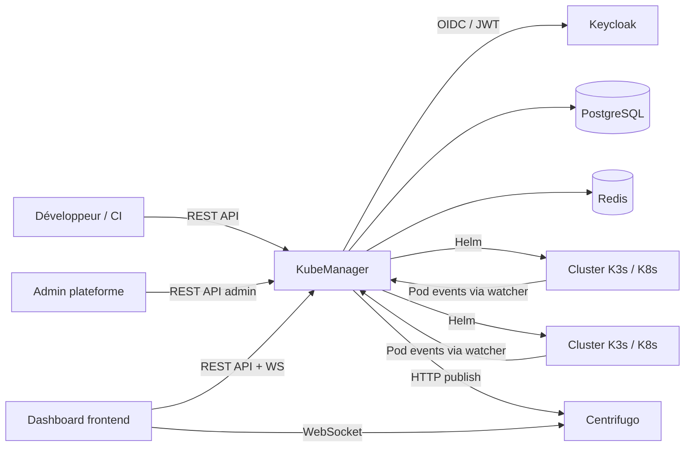
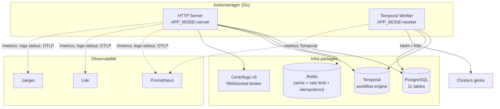
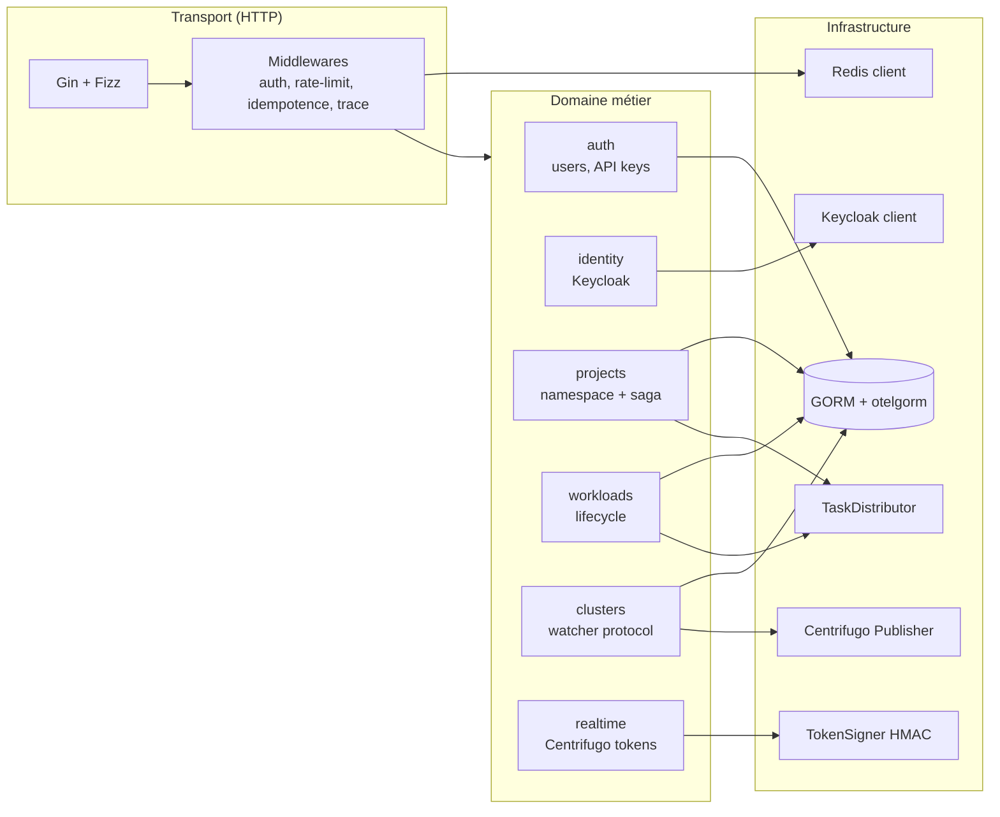
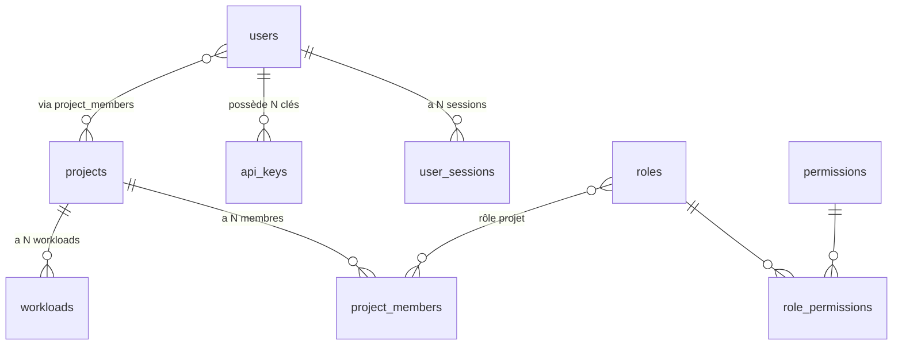

# Architecture — vue d'ensemble

> Une page, trois diagrammes, trois niveaux de zoom.

## C4 niveau 1 — Contexte

Qui parle à KubeManager et à quoi il parle.

**Responsabilité de kubemanager** : être le plan de contrôle. Piloter N clusters K8s distants, exposer une API unifiée pour les devs, broadcaster les events live aux frontends.

## C4 niveau 2 — Containers

Les processus qui tournent dans un déploiement kubemanager (le binaire + ses dépendances).

**Un seul binaire**, deux modes sélectionnés par `APP_MODE` :
- `server` — expose l'API HTTP, démarre pas de worker Temporal.
- `worker` — consomme la task queue Temporal, exécute les activities.

Permet de scaler indépendamment (HPA sur le deploy server, nombre fixe de workers).

## C4 niveau 3 — Composants (mode server)

Les paquets Go dans le binaire quand il tourne en `APP_MODE=server`.

**Règles d'import** :
- Un module métier peut importer un `infrastructure/*` → ✅.
- Un module métier peut importer les `repository/` d'un autre module → ✅ (cross-module read).
- Un module métier peut importer `service/` d'un autre module → ❌ refusé en review (couplage fort).
- `infrastructure/*` ne peut pas importer `modules/*` → ✅ (direction unique).

## Données — 11 tables, 4 zones

Zones :

| Zone | Tables |
|------|--------|
| Auth & sessions | `users`, `user_sessions`, `revoked_tokens` |
| RBAC | `roles`, `permissions`, `role_permissions`, `project_members` |
| Ressources | `projects`, `workloads`, `api_keys` |
| Fleet | `clusters` |

Schéma complet : [migrations/000001_init.up.sql](../../migrations/000001_init.up.sql).

## Choix structurants

Pour ne pas répéter les "pourquoi" ici, voir les ADRs :

- [ADR-0001 — Temporal plutôt qu'Asynq](../adr/0001-temporal-over-asynq.md)
- [ADR-0002 — Helm SDK v3 intégré plutôt que shell](../adr/0002-helm-sdk-v3.md)
- [ADR-0003 — Centrifugo fail-open](../adr/0003-centrifugo-fail-open.md)
- [ADR-0004 — Cluster watcher comme binaire séparé](../adr/0004-cluster-watcher-separate.md)

## Prochaine lecture

- [Cycle de vie d'une requête](request-lifecycle.md) — le parcours `POST /workloads` de bout en bout.
- [Sagas Temporal](temporal-sagas.md) — compensation, idempotence, retry policy.
- [Sécurité](security.md) — auth chain, RBAC, NetworkPolicy.
