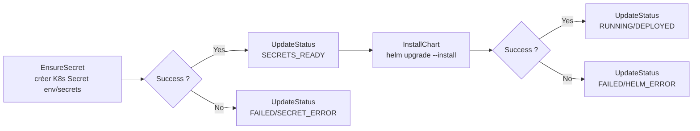

# Cycle de vie d'une requête — `POST /workloads`

> De la ligne de commande client à la pod qui tourne dans un cluster distant, en passant par la DB, Temporal, Helm et Centrifugo.

## Entrée — la commande client

```sh
curl -X POST https://api.kubemanager/kmanager/v1/workloads \
  -H "Authorization: Bearer $TOKEN" \
  -H "Content-Type: application/json" \
  -H "Idempotency-Key: deploy-$(uuidgen)" \
  -d '{
    "project_id": "abc-123-uuid",
    "name": "api",
    "image": "myregistry/app:v1.2.3",
    "replicas": 3,
    "cpu_limit": "500m",
    "memory_limit": "512Mi",
    "target_port": 8080,
    "env_vars": {"NODE_ENV": "production"},
    "secret_data": {"DATABASE_URL": "..."}
  }'
```

## Schéma global

```mermaid
sequenceDiagram
    actor Client
    participant Gin as Gin + Fizz
    participant MW as Middlewares
    participant Ctrl as WorkloadController
    participant Svc as WorkloadService
    participant ProjRepo as ProjectRepo
    participant WlRepo as WorkloadRepo
    participant Dist as TaskDistributor
    participant Temp as Temporal
    participant Worker as Temporal Worker
    participant K8s as Cluster K3s
    participant Centri as Centrifugo
    participant Front as Frontend (WS)

    Client->>Gin: POST /workloads + JWT
    Gin->>MW: Recovery → SecureHeaders → OTEL trace → RateLimit → Auth → Idempotence
    MW->>Ctrl: CreateWorkload(c, in)
    Ctrl->>Svc: Deploy(ctx, req)
    Svc->>ProjRepo: GetProjectByID(projectID)
    Svc->>WlRepo: GetTotalUsageByProject — quota check
    Note over Svc: Quota CPU/mem OK ?<br/>Port non-réservé ?
    Svc->>WlRepo: Create(workload) — status STARTING
    Svc->>Dist: ExecuteWorkflow(DeployWorkloadWorkflow, input)
    Dist->>Temp: StartWorkflow RPC
    Temp-->>Dist: WorkflowID + RunID
    Svc-->>Ctrl: WorkloadResponse
    Ctrl-->>Client: 202 Accepted { workload_id, status: "STARTING" }

    Note right of Temp: ASYNC à partir d'ici
    Temp->>Worker: deliver workflow task
    Worker->>K8s: EnsureSecret (idempotent, TTL 10 min)
    Worker->>K8s: InstallChart (helm upgrade --install)
    K8s-->>Worker: release deployed
    Worker->>WlRepo: UpdateStatus("RUNNING", "DEPLOYED")
    Worker->>Centri: Publish deploy:project:X:workload:Y
    Centri->>Front: WS event { status: "RUNNING" }
```



## Étape par étape

### 1. Gin reçoit la requête (port :8080)

Route déclarée dans [internal/infrastructure/router/route.go:140](../../internal/infrastructure/router/route.go#L140) :

```go
WorkloadGroup.AddRoute("", http.MethodPost,
    "Déployer un nouveau workload",
    tonic.Handler(r.CreateWorkload, http.StatusAccepted))
```

Le groupe `WorkloadGroup` préfixe `/kmanager/v1/workloads`.

### 2. Chaîne middleware globale

Dans l'ordre, posée dans [internal/infrastructure/router/server.go](../../internal/infrastructure/router/server.go) :

1. **Recovery** — catch panic, 500.
2. **SecureHeaders** — CSP, X-Frame-Options, etc.
3. **OTEL trace** — span racine + trace_id dans le ctx + logger scopé.
4. **RateLimit** — token bucket Redis fixed-window 300 req/min par IP.
5. **Auth** — valide le JWT via JWKS Keycloak, ou une API key via X-API-Key. Pose `userID` dans `c`.
6. **Idempotence** — si `Idempotency-Key` présent, hash body + scope `userID + method + path` ; réplay si déjà traité.

Si n'importe lequel refuse → abort, pas d'appel au controller.

### 3. Controller — parsing + délégation

[internal/modules/workloads/workloads.go](../../internal/modules/workloads/workloads.go) :

```go
func (h *WorkloadController) CreateWorkload(c *gin.Context, in *domain.CreateWorkloadRequest) (*domain.WorkloadResponse, error) {
    userID := c.GetString("userID") // posé par auth middleware
    svcReq := &service.WorkloadServiceRequest{CreateWorkloadRequest: *in}
    workload, err := h.WorkloadService.Deploy(c.Request.Context(), svcReq)
    // ...
}
```

Tonic a déjà parsé le body + validé les `binding:"required"`.

### 4. Service — logique métier

[internal/modules/workloads/service/deploy.go](../../internal/modules/workloads/service/deploy.go) :

```
1. Parse projectID
2. Lookup Project (name, quotas configurés)
3. GetTotalUsageByProject (somme CPU/mem/storage des workloads existants)
4. Vérifie : currentCPU + requestedCPU ≤ project.CpuLimit ?
5. Vérifie : port cible non-réservé (8080 est bloqué, réservé à kubemanager lui-même)
6. Build workload struct (status=STARTING, phase=HELM_CHART_LOADING)
7. Create DB row
8. Submit DeployWorkloadWorkflow via TaskDistributor
9. Return WorkloadResponse { workload_id, status }
```

La DB row est créée **avant** le workflow — si le worker plante, on retrouve la row en DB avec status STARTING et on peut retry.

### 5. Réponse au client

202 Accepted — on a accepté la demande, on n'a pas encore déployé. Le client doit :
- soit poll `GET /workloads/:id/status`,
- soit écouter le channel Centrifugo `project:X:workload:Y:deploy`.

## Suite asynchrone — workflow Temporal

### 6. Worker consomme la task

Le worker (binaire `kubemanager` en `APP_MODE=worker`) poll la task queue `kubemanager-queue`, récupère la task, exécute `DeployWorkloadWorkflow`.

Workflow : [internal/modules/workloads/workflows/deployWorkload.go](../../internal/modules/workloads/workflows/deployWorkload.go).

Séquence d'activities :



Chaque activity est encapsulée par `idempotency.ExecuteActivity(ctx, ...)` → clé Redis (hash de l'input) + TTL 10 min. Si la task est réjouée (retry Temporal), la clé existe déjà → no-op.

### 7. `InstallChart` concrètement

[internal/modules/workloads/activities/heml.go:77](../../internal/modules/workloads/activities/heml.go#L77) :

1. Charge le chart `standard-app` depuis [internal/infrastructure/helm/charts/standard-app/](../../internal/infrastructure/helm/charts/standard-app/).
2. Construit les `values.yaml` à partir de l'input (image, replicas, resources, envSecretName, ingress, persistence…).
3. Appelle le Helm SDK v3 `action.NewUpgrade().Run(...)` avec `CreateIfMissing=true`, `Wait=true`, `Timeout=5min`.
4. Helm crée/update : Deployment + Service + Ingress + (si persistence) PVC + HPA + PDB + NetworkPolicy + ServiceAccount.
5. Helm attend que le Deployment soit `Ready` (pods démarrés + probes OK).

### 8. Status update + broadcast

[internal/modules/workloads/activities/db.go:UpdateWorkloadStatus](../../internal/modules/workloads/activities/db.go) :

```
1. UPDATE workloads SET status=..., current_phase=... WHERE id=...
2. Increment metric kubemanager_workload_status_transitions_total
3. Publish Centrifugo:
   - channel project:<pid>:workload:<wid>:deploy (granularité workload)
   - channel project:<pid>:events (dashboard projet)
4. Les erreurs Centrifugo sont loggées mais pas remontées (fail-open)
```

### 9. Frontend reçoit l'event

Le dashboard a obtenu un subscription token via `GET /realtime/subscribe?channel=project:X:workload:Y:deploy` ([realtime/hrealtime.go](../../internal/modules/realtime/hrealtime.go)) et s'est abonné à Centrifugo. Il reçoit :

```json
{
  "workload_id": "abc-123",
  "project_id": "xyz-789",
  "status": "RUNNING",
  "phase": "DEPLOYED",
  "at": "2026-04-18T10:23:42Z"
}
```

## Et si ça foire ?

Voir [Temporal sagas](temporal-sagas.md) pour les scénarios d'erreur détaillés et [runbook](../interne/runbook.md) → "Déploiements workloads coincés" pour le diagnostic oncall.

## Latence attendue

| Étape | P50 | P95 |
|-------|-----|-----|
| Controller → réponse 202 | 40 ms | 150 ms |
| Submit Temporal | 10 ms | 50 ms |
| Activity `EnsureSecret` | 100 ms | 500 ms |
| Activity `InstallChart` (wait=true) | 15 s | 60 s |
| Status `RUNNING` côté Centrifugo | 20 s (P50) | 90 s (P95) |

Le facteur dominant = `wait=true` du Helm SDK (il attend readiness des pods). Pour les images déjà en cache sur le node, c'est 3-5 s ; pour un pull + démarrage d'une JVM, ça peut monter à 60-90 s.

## Points d'observabilité le long du parcours

| Couche | Où regarder |
|--------|-------------|
| Gin → handler | dashboard Grafana "KubeManager — Overview", métrique `gin_request_duration_seconds{handler="/workloads"}` |
| Service | trace Jaeger (trace_id dans le header de réponse) |
| DB | span OTEL GORM dans la même trace |
| Temporal | Temporal UI (`temporal-ui.kubemanager`) filtrer par `WorkflowID=deploy-workload-<wid>` |
| K8s | `kubectl -n km-<project> get events --sort-by='.lastTimestamp'` |
| Frontend WS | onglet Network du navigateur, filtre `websocket` |

## Prochaine lecture

- [Sagas Temporal](temporal-sagas.md) — compensation et retries.
- [Module workloads](../modules/workloads.md) — tous les endpoints + le DTO complet.
