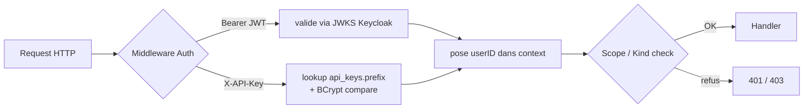

# Sécurité

> Comment on authentifie, autorise, isole les tenants et durcit les workloads déployés.

## Chaîne d'authentification



### JWT Bearer

- Émis par Keycloak (realm `kubemanager`, client `kubemanager-api`).
- Signé en RS256, clé publique récupérée via `/protocol/openid-connect/certs` (JWKS endpoint).
- Claims vérifiés : `iss`, `aud`, `exp`, `sub`.
- Middleware : [internal/middleware/security/middleware.go:125](../../internal/middleware/security/middleware.go#L125) (`AuthMiddleware()`).
- `userID` = claim `sub`. `roles` = `resource_access[<client>].roles`.

### API Key

- Format : `km_<prefix>_<random_secret>` (prefix visible, secret hashé BCrypt).
- Lookup : `SELECT * FROM api_keys WHERE prefix = $1 AND is_active = true AND (expires_at IS NULL OR expires_at > NOW())`.
- Comparaison : `subtle.ConstantTimeCompare(bcrypt.Hash(secret), row.KeyHash)` — protège contre timing attacks.
- Compteur `usage_count` + `last_used_at` incrémentés en batch (fix P4) pour éviter le hot row sur une clé très utilisée.
- Middleware : [internal/middleware/apikey_auth.go](../../internal/middleware/apikey_auth.go).
- Gestion admin : [internal/modules/auth/hApikey.go](../../internal/modules/auth/hApikey.go).

### Scope (API keys) + Kind (API keys)

Chaque API key porte un `kind` et des `scopes` :

| Kind | Usage | Scopes typiques |
|------|-------|-----------------|
| `backend` (défaut user) | CLI/CI des devs | `project:read`, `workload:write` |
| `cluster` | Watcher K8s | `cluster:report` |

Middleware dédié pour scope cluster : `RequireAPIKeyKind("cluster")` posé sur `/clusters/*` dans [route.go:31](../../internal/infrastructure/router/route.go#L31).

## Chaîne middleware complète

Dans l'ordre, posée dans [server.go](../../internal/infrastructure/router/server.go) :

```
1. Recovery             panic → 500, évite le kill-9 du process
2. SecureHeaders        CSP, X-Content-Type-Options, Strict-Transport-Security
3. CORS                 AllowOrigins depuis config.Server.AllowedOrigins
4. OTEL trace           span racine + trace_id dans ctx + logger scopé
5. RateLimit            Redis fixed-window 300 req/min par IP (fail-closed)
6. Auth                 JWT Bearer OU API key — pose userID
7. TenantResolver       path/:projectID → pose projectID
8. Idempotence          Idempotency-Key header → scope par userID+method+path
```

Refus possibles à chaque niveau → status 4xx avec code d'erreur typé dans le body.

## RBAC projet

Une fois auth OK, les droits dépendent du projet ciblé. Source de vérité :

```sql
-- Qui peut faire quoi sur un projet
SELECT p.slug
FROM project_members pm
JOIN roles r ON r.id = pm.role_id
JOIN role_permissions rp ON rp.role_id = r.id
JOIN permissions p ON p.id = rp.permission_id
WHERE pm.project_id = $1 AND pm.user_id = $2 AND pm.status = 'ACTIVE';
```

Les autorisations passent par le moteur IAM (`internal/iam`, design : [iam.md](iam.md)) : `iam.Engine.Check(principal, permission, ressource)`, avec héritage organisation → projet → ressource.

**Chaque route déclare son accès** dans [route.go](../../internal/infrastructure/router/route.go), argument obligatoire de `AddRoute` (une route sans accès ne compile pas, une valeur vide fait échouer le démarrage) :

| Accès | Sens |
|-------|------|
| `Public()` | Sans authentification. Ces routes sont transmises à l'AuthMiddleware : plus de liste de chemins à maintenir. |
| `Authenticated()` | Tout utilisateur authentifié ; le handler ne touche qu'aux données de l'appelant. |
| `g.Perm(iam.X, resolver)` | Permission IAM `X` sur la ressource trouvée par le resolver : `ProjectParam`, `ProjectQuery`, `ProjectJSONBody`, `ProjectChild`, `PlatformResource`, ou un resolver de module (ex. `workloadResource`). |
| `g.APIKeyKind("cluster")` | Clé API d'un type donné (watcher). |

La permission exigée apparaît dans la description OpenAPI de chaque opération. Un refus renvoie `403 {"code":"PERMISSION_DENIED","permission":"…"}`. Si le moteur IAM est indisponible, l'accès est refusé (503), jamais accordé.

Clés API v2 (`btr_live_…`) : toujours rattachées à un compte de service, présentées en `X-API-Key` ou `Authorization: Bearer`. Leurs restrictions (permissions, ressources, IP) s'ajoutent aux rôles du compte. Créer une clé exige `iam.serviceAccounts.actAs` sur le compte. Secret stocké en HMAC-SHA256 avec un pepper serveur (`KUBEMANAGER_IAM_API_KEY_PEPPER`, obligatoire au démarrage).

Clés legacy `km_…` : rattachées par la migration 000007 à un compte de service `legacy-…` par (projet, utilisateur), avec les rôles de l'utilisateur sur ce projet uniquement ; elles expirent au plus tard 90 jours après la migration. `POST /users/api-keys` répond 410 : les nouvelles clés se créent sur un compte de service. Les clés de cluster (watcher) ne changent pas.

Staff betorun : les rôles Keycloak `SUPER_ADMIN`/`ADMIN` ne donnent plus aucun droit. Le staff est déclaré dans `iam.platform_admins` / `iam.platform_support` (emails), réconcilié en bindings sur `platform` au démarrage puis toutes les 10 minutes. Les rôles plateforme ne donnent aucun accès aux projets clients.

Journal d'audit : toute écriture d'un principal authentifié et tout refus sont enregistrés dans `audit_log` (append-only : `UPDATE`, `DELETE` et `TRUNCATE` refusés par trigger), consultable via `GET /iam/auditLogs?resource=…` avec `logging.auditLogs.read`.

Fraîcheur : un droit accordé est effectif immédiatement (un refus relit toujours la base) ; un droit retiré est diffusé à tous les process via Redis (`iam:invalidate`), et au pire expire avec le cache (5 s).

### Erreurs HTTP

Le hook tonic ([router/errors.go](../../internal/infrastructure/router/errors.go)) renvoie `{code, message, error}` :
- erreur typée `betoerrors` → statut du code ;
- `gorm.ErrRecordNotFound` et sentinelles connues → 404/401/409… ;
- toute autre erreur → **500 « internal server error »**, cause journalisée mais jamais renvoyée.

Une erreur destinée au client doit donc être typée (`betoerrors.New(betoerrors.CodeInvalidInput, "…")`).

Rôles projet :

| Rôle | Permissions |
|------|-------------|
| `OWNER` | tout, y compris delete project, invite/kick members |
| `ADMIN` | workloads CRUD, invite members (pas de delete project) |
| `DEVELOPER` | workloads CRUD, pas de member management |
| `VIEWER` | read-only workloads + logs |

## Rôles globaux (plateforme)

Claim `role` du JWT Keycloak :

| Rôle | Endpoints admin ouverts |
|------|-------------------------|
| `SUPER_ADMIN` | tout (`/admin/*`) |
| `ADMIN` | `/admin/clusters`, `/admin/cluster-keys` |
| `USER` | aucun `/admin/*` |

Middleware : `RequireGlobalRole(allowed ...string)` — posé sur les groupes admin dans [route.go:49,108](../../internal/infrastructure/router/route.go#L49).

## Secrets

- **Pas de secrets en clair dans le repo**. Voir [interne/secrets-management.md](../interne/secrets-management.md).
- Chaîne recommandée prod : Vault → ExternalSecrets operator → K8s Secret `kubemanager-secrets` → envFrom dans le Deployment.
- Alternative : SOPS + age pour un flow GitOps.

## Isolation tenant

### Niveau DB

Tous les repos **doivent** filtrer par `project_id` sur les ressources tenant. Reviewer doit refuser une PR qui :
- manque le `WHERE project_id = ?`,
- ou laisse passer un `SELECT *` sans scope.

### Niveau K8s

- **Un projet = un namespace** (`km-<project-name>`).
- **Un workload = une release Helm** dans le namespace du projet.
- **ResourceQuota** posé à la création du projet (CPU/mem/storage max).
- **NetworkPolicy** deny-by-default + allowlist ingress-nginx + egress DNS/HTTPS.
- **PSA restricted** sur tous les pods utilisateurs (voir `containerSecurityContext` dans le chart).

### Niveau Keycloak

- Un projet = un groupe Keycloak `project-<uuid>`.
- Les membres sont ajoutés au groupe au moment du `POST /project-members`.
- Le JWT Keycloak porte la liste des groupes → extraits côté kubemanager pour le RBAC.

## Durcissement des workloads utilisateurs

Le chart `standard-app` applique par défaut :

```yaml
podSecurityContext:
  runAsNonRoot: true
  runAsUser: 1000
  runAsGroup: 1000
  fsGroup: 2000
  seccompProfile:
    type: RuntimeDefault

containerSecurityContext:
  allowPrivilegeEscalation: false
  readOnlyRootFilesystem: true
  runAsNonRoot: true
  runAsUser: 1000
  capabilities:
    drop: ["ALL"]

serviceAccount:
  automountServiceAccountToken: false   # pas de token SA dans le pod

tmpfs:
  enabled: true                          # /tmp et /var/run en emptyDir medium:Memory
```

Avec `readOnlyRootFilesystem: true`, les apps qui ont besoin d'écrire doivent :
1. Utiliser `tmpfs` (64 Mi) pour les caches temporaires.
2. Monter un PVC pour les données persistantes (Mount path configurable).

Voir [interne/helm-hardening.md](../interne/helm-hardening.md) pour tous les détails et la checklist pre-prod.

## Durcissement réseau

### Ingress

- Entrée HTTPS via cert-manager + Let's Encrypt (annotations auto dans le chart).
- `nginx.ingress.kubernetes.io/proxy-body-size: 50m` par défaut.
- TLS obligatoire en prod (configurable via `ingress.tls.enabled`).

### NetworkPolicy

```yaml
ingress:
  - from:
      - podSelector: {matchLabels: <selfLabels>}   # entre pods de la même release
  - from:
      - namespaceSelector: {matchLabels: {name: ingress-nginx}}  # ingress controller

egress:
  - to:
      - namespaceSelector: {matchLabels: {name: kube-system}}    # DNS
  - to:
      - ipBlock: {cidr: 0.0.0.0/0, except: [10.0.0.0/8, 172.16.0.0/12, 192.168.0.0/16]}  # HTTPS public
    ports: [{protocol: TCP, port: 443}]
```

Le workload ne peut donc **pas** attaquer les autres namespaces (ni les autres workloads du même projet si on passait en `strict`, aujourd'hui non activé).

## Observabilité sécurité

- **Audit log** : toutes les tentatives d'auth (OK + refus) sont loggées avec sampling adaptatif. [middleware/audit.go](../../internal/middleware/audit.go).
- **Metrics** : `gin_requests_total{code=~"401|403"}` dans le dashboard Grafana.
- **Alert PrometheusRule** : `KubeManagerRateLimitStorm` si > 5 req/s de 429 soutenu.

## Revue de sécurité — avant chaque release majeure

Checklist :

- [ ] Scan deps (govulncheck) en CI vert.
- [ ] `helm template | kube-linter` sur `standard-app`.
- [ ] Grafana dashboard "auth 401/403 rate" sans pic anormal sur les 7 derniers jours.
- [ ] Aucun secret commité (gitleaks ou detect-secrets).
- [ ] Rotation vérifiée : `/admin/cluster-keys/:id/rotate` fonctionne (smoke).
- [ ] Runbook à jour.

## Prochaine lecture

- [Observabilité](observability.md) — logs, métriques, traces.
- [Secrets management](../interne/secrets-management.md).
- [Helm hardening détaillé](../interne/helm-hardening.md).
