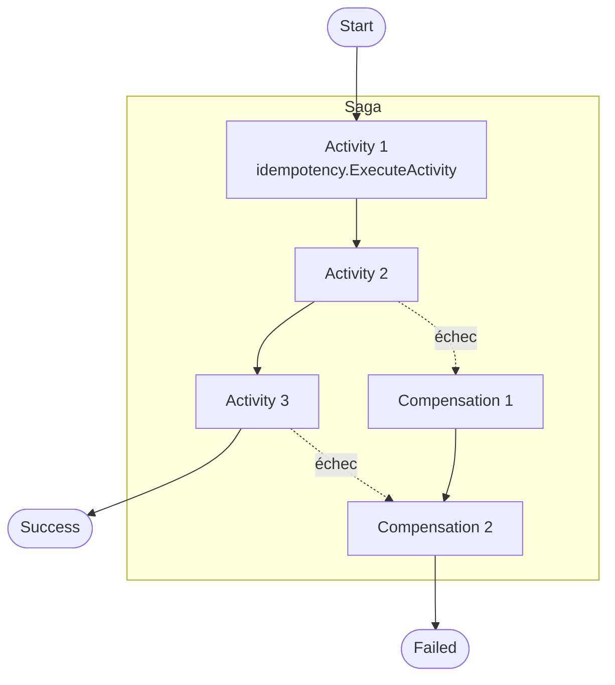

# Sagas Temporal

> Pourquoi Temporal, comment on l'utilise, et les 4 règles non-négociables pour écrire un nouveau workflow.

## Pourquoi Temporal chez nous

On a des opérations qui touchent **plusieurs systèmes** (DB + K8s + Keycloak + Centrifugo) et qui sont **longues** (un helm install peut prendre 60 s). On ne peut pas les faire dans le handler HTTP parce que :

1. Un timeout HTTP → travail partiellement appliqué → données inconsistantes.
2. Un retry naïf → effets dupliqués (ex: deux helm install).
3. Un crash serveur → l'état de progression est perdu.

Temporal répond aux 3 :

- **Durable** : l'état du workflow est persisté, survit aux restart.
- **Retry + idempotence** : chaque activity peut retry, et on protège par clé d'idempotence Redis.
- **Compensation** : chaque workflow déclare sa séquence inverse en cas d'échec partiel (pattern saga).

Voir aussi [ADR-0001](../adr/0001-temporal-over-asynq.md) pour l'historique du choix.

## Anatomie d'un workflow



Règles :

1. **Chaque activity est idempotente** — un retry ne doit produire aucun effet supplémentaire (ex: créer 2 namespaces, relancer un helm install). On enveloppe via `idempotency.ExecuteActivity(ctx, mgr, input, opts, fn)` qui crée une clé Redis hashée sur l'input + TTL 10 min.

2. **Chaque activity a une compensation explicite** (ou une justification claire si pas). Exemple : `CreateProjectInDB` → compensée par `DeleteProjectDBActivity` si la suite échoue.

3. **L'ordre des compensations est inverse** à l'ordre d'exécution.

4. **Une compensation doit être idempotente aussi** — elle sera réjouée si le retry du rollback plante.

## Workflows existants

| Workflow | Où | Activities | Compensation |
|----------|-----|-----------|--------------|
| `CreateProjectWorkflow` | [projects/workflows/create.go](../../internal/modules/projects/workflows/create.go) | CreateProjectInDB → CreateNamespace → ReconcileProjectResources → AssignDefaultOwner | `DeleteProjectDBActivity` si namespace échoue |
| `DeleteProjectWorkflow` | [projects/workflows/delete.go](../../internal/modules/projects/workflows/delete.go) | DeleteNamespace → DeleteProjectWorkloadsActivity → DeleteProjectSiteObjects → DeleteProjectDBActivity ; lancé par la purge 12 h après la demande (suppression programmée, restaurable d'ici là) | pas de compensation (opérations toutes idempotentes + destructives) |
| `DeployWorkloadWorkflow` | [workloads/workflows/deployWorkload.go](../../internal/modules/workloads/workflows/deployWorkload.go) | EnsureSecret → InstallChart → UpdateStatus | `UpdateStatus(FAILED)` + garder la DB row pour retry manuel |
| `DeleteWorkloadWorkflow` | [workloads/workflows/deleteWorkload.go](../../internal/modules/workloads/workflows/deleteWorkload.go) | UninstallChart → SoftDeleteWorkload | `UpdateStatus(DELETE_FAILED)` si Helm échoue (pas de re-install auto, admin retry) |

## Retry policy standard

Définie dans chaque workflow via `workflow.ActivityOptions` :

```go
options := workflow.ActivityOptions{
    StartToCloseTimeout: 5 * time.Minute,
    RetryPolicy: &temporal.RetryPolicy{
        InitialInterval: time.Second,
        MaximumAttempts: 3,
        MaximumInterval: time.Minute,
    },
}
```

3 tentatives par activity. Entre les tentatives : 1 s → 2 s → 4 s (backoff exponentiel, capé à 1 min).

**Exception** : les activities qui ont des effets externes coûteux (helm install) peuvent avoir un `MaximumAttempts: 1` si on veut échouer franc plutôt que pilonner le cluster.

## L'idempotence — pattern Begin / Complete / Fail

[internal/infrastructure/idempotence/](../../internal/infrastructure/idempotence/) expose un `AtomicManager` avec 3 primitives Redis :

```
Begin(key, hash, ttl, dst)   → BeginStatus {Started | InProgress | Completed | Failed}
Complete(key, hash, resp)     → marque Completed + stocke le résultat
Fail(key, hash)               → clean-up si l'activity a fini en erreur
```

Dans une activity :

```go
func (a *Act) MyActivity(ctx context.Context, in Input) error {
    payload := struct{ A, B string }{in.A, in.B}
    _, _, err := idempotency.ExecuteActivity(ctx, a.Idempotency, payload,
        idempotency.ActivityOptions{ProcessingTTL: 2 * time.Minute},
        func() (struct{}, error) {
            // effet externe ici
            return struct{}{}, nil
        },
    )
    return err
}
```

Garanties :

- **Completed** → on récupère le résultat mis en cache, on ne re-exécute pas.
- **InProgress** → 409 Conflict au 2e appel concurrent (une autre réplica fait déjà le job).
- **Started** → on exécute la fonction, on pose Complete à la fin.

TTL typique : 2 min (suffisant pour une activity Helm, court pour libérer la clé).

## Décider : workflow ou pas workflow ?

**Workflow nécessaire** si :
- > 1 système impacté (DB + K8s, DB + Keycloak, etc.).
- Durée > 5 s (timeouts HTTP commencent à gêner).
- Besoin de retry automatique.
- Besoin de compensation en cas d'échec partiel.

**Pas besoin de workflow** (appel K8s/Helm direct depuis le service) :
- Opération atomique côté K8s (`kubectl scale`, `kubectl rollout restart`).
- Durée < 2 s.
- Pas d'effet DB à reverter.

Exemples "pas de workflow" chez nous : `Stop`, `Start`, `Restart`, `Rollback` — tous dans [workloads/service/lifecycle.go](../../internal/modules/workloads/service/lifecycle.go).

## Tester un workflow

Utiliser `go.temporal.io/sdk/testsuite` :

```go
var ts testsuite.WorkflowTestSuite
env := ts.NewTestWorkflowEnvironment()
fake := &fakeActs{}
env.RegisterActivity(fake.CreateNamespace)
env.RegisterActivity(fake.DeleteProjectDBActivity)
// ...
env.ExecuteWorkflow(CreateProjectWorkflow, CreateProjectInput{Name: "alpha"})

require.True(t, env.IsWorkflowCompleted())
require.NoError(t, env.GetWorkflowError())
```

**Contrainte** : les méthodes des fake activities doivent avoir la **même signature exacte** (incluant `ctx context.Context`, pas `_ any`) pour que la reflection Temporal les matche correctement.

Voir les tests existants :
- [workloads/workflows/deleteWorkload_test.go](../../internal/modules/workloads/workflows/deleteWorkload_test.go)
- [projects/workflows/delete_test.go](../../internal/modules/projects/workflows/delete_test.go)
- [projects/workflows/create_test.go](../../internal/modules/projects/workflows/create_test.go)

## Prochaine lecture

- [Request lifecycle](request-lifecycle.md) — le parcours complet d'un POST /workloads.
- [How-to: ajouter un workflow Temporal](../how-to/ajouter-un-workflow-temporal.md).
