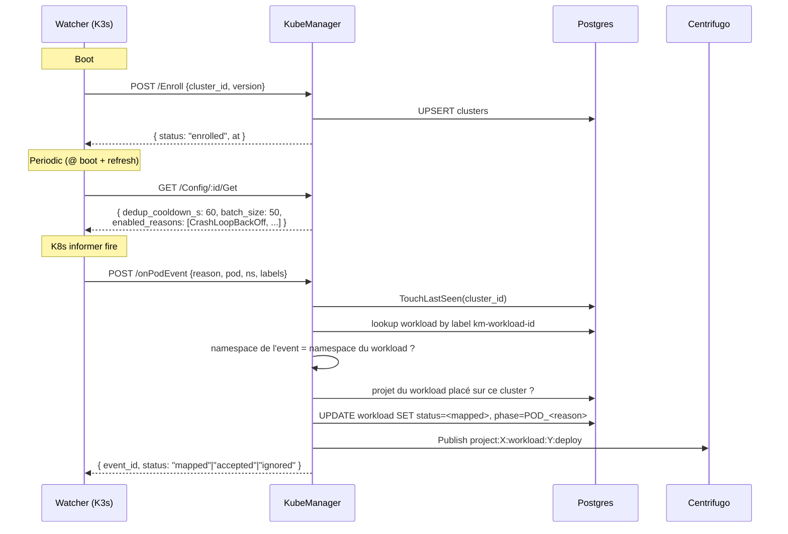

# Module `clusters`

> Enregistrement des clusters K8s distants + ingestion des pod events via le binaire `watcher` (projet séparé). Protocole Restate-compatible.

## Responsabilités

- Enroll d'un cluster au démarrage de son watcher.
- Fournir la config remote (dedup cooldown, batch size, enabled reasons K8s) au watcher.
- Ingérer chaque pod event significatif → update du workload + broadcast Centrifugo.
- Recevoir les clés publiques des jetons de comptes Kubernetes du cluster (identité des workloads, contrôleur `iamapi`).
- **Registre multi-cluster** (socle multi-cluster, lot 1) : l'équipe déclare chaque cluster (fournisseur, distribution, région, état), dépose son accès chiffré et choisit le cluster par défaut, depuis le back-office.
- **Santé** de chaque cluster, relevée chaque minute par le worker (API, nœuds, capacité, pods en échec, signe de vie du watcher), exposée à Prometheus (alertes `ClusterDown`, `ClusterDegraded`).

## Endpoints HTTP

### Watcher protocol — sous `/kmanager/v1/clusters`

Routes internes déclarées dans `addClusterRoutes` ([route.go](../../internal/infrastructure/router/route.go)), accès `g.ClusterAgent(...)` : l'appelant doit être le **compte de service système du cluster visé** (identifiant lu dans `:clusterID`, ou `cluster_id` du corps pour Enroll) et détenir `platform.clusters.report` ([middleware/security/cluster_agent.go](../../internal/middleware/security/cluster_agent.go)). La clé d'un cluster ne vaut que pour ce cluster.

| Méthode | Chemin | Description |
|---------|--------|-------------|
| `POST` | `/ClusterService/Enroll` | Enregistrement au boot du watcher |
| `GET` | `/ConfigService/:clusterID/Get` | Config remote (dedup, reasons, batch) |
| `POST` | `/ProjectService/:clusterID/onPodEvent` | Un pod event reçu |
| `POST` | `/ClusterService/:clusterID/ServiceAccountKeys` | Clés publiques des jetons de comptes Kubernetes du cluster (204) |
| `GET` | `/EdgeService/:clusterID/Resolve?host=` | static-edge du cluster : site servi pour un nom d'hôte (`site_id`, `deployment_id`, `spa_fallback`), 404 sinon. Même garde que le watcher (module `sites`, `hedge.go`) |

### Admin — sous `/kmanager/v1/admin/clusters`

Routes internes sur `platform` (staff). `platform.clusters.manage` est **sensible** (double authentification) ; écran : back-office « Clusters ».

| Méthode | Chemin | Permission | Description |
|---------|--------|-----------|-------------|
| `GET` | `/admin/clusters` | `platform.clusters.list` | Registre : champs du watcher (`cluster_id`, `version`, `last_seen_at`, `enrolled_at`), du registre (`name`, `provider`, `distribution`, `region`, `state`, `is_default`, `notes`, `api_server`, `kubeconfig_set_at`), `has_kubeconfig`, `from_config`, dernier relevé `health` |
| `POST` | `/admin/clusters` | `platform.clusters.manage` | Déclarer un cluster (sans accès) |
| `GET` | `/admin/clusters/:clusterID` | `platform.clusters.list` | Un cluster et son relevé |
| `PATCH` | `/admin/clusters/:clusterID` | `platform.clusters.manage` | Nom, fournisseur, distribution, région, état, notes |
| `DELETE` | `/admin/clusters/:clusterID` | `platform.clusters.manage` | Retrait (jamais le défaut : `409 DEFAULT_CLUSTER`) ; la clé du watcher se révoque sous `/admin/cluster-keys` |
| `PUT` | `/admin/clusters/:clusterID/kubeconfig` | `platform.clusters.manage` | Dépôt de l'accès : contrôlé, testé (le cluster doit répondre, sinon `422 CLUSTER_UNREACHABLE` ; droits de lecture des nœuds ou pods refusés : `422 CLUSTER_ACCESS_DENIED`), chiffré, jamais rendu |
| `POST` | `/admin/clusters/:clusterID/default` | `platform.clusters.manage` | Cluster par défaut (un seul ; pas un cluster `disabled`) |
| `POST` | `/admin/clusters/:clusterID/check` | `platform.clusters.list` | Relevé de santé immédiat |
| `GET` | `/admin/clusters/:clusterID/nodes` | `platform.clusters.list` | Nœuds lus à l'instant (prêt, rôles, allouable, demandes) |

## Registre multi-cluster (lot 1)

- **Déclaration** : un cluster peut être déclaré avant que son watcher ne s'enrôle (`enrolled_at` vide) ; l'enrôlement garde la déclaration. Un watcher qui s'enrôle sans déclaration crée une ligne (fournisseur `other`, distribution `k3s`) à compléter.
- **Fournisseur** `ovh` | `proxmox` | `other`, **distribution** `k3s` | `k8s`, **région** (minuscules, chiffres, tirets).
- **État** : `active` (recevra de nouveaux projets au lot 2), `closed` (garde ses projets, n'en reçoit plus), `disabled` (hors service, plus sondé ; interdit pour le défaut).
- **Cluster par défaut** : celui de la configuration du déploiement (`kubernetes.cluster_id`) est inscrit au démarrage et devient le défaut s'il n'y en a aucun ; il est lu par le client Kubernetes du process (`from_config`). Un seul défaut (index unique).
- **Accès** (`kubeconfig_ciphertext`) : chiffré par la clé maître (`iam.sts_key_encryption_key`), AAD lié au cluster (un chiffré ne sert pas à un autre). Refusé : greffon `exec` ou `auth-provider` (lancerait une commande sur nos serveurs), chemins de fichiers locaux (certificats, jeton), serveur non https, utilisateur sans jeton ni certificat. Tout le fichier est contrôlé, pas seulement le contexte courant. Délai de 10 s par appel, client mis en cache jusqu'au prochain dépôt.

## Placement des projets (lot 2a)

- Chaque projet porte son cluster (`projects.cluster_id`, migration 000070 ; NULL : cluster par défaut, projets existants rattachés au défaut). L'identifiant du cluster n'est jamais montré au client (marque blanche).
- **Régions** : `GET /regions` (client connecté) rend les régions des clusters `active` (`code`, `available`, `default`) ; un cluster sans région n'est pas proposé. Le client passe `region` à `POST /projects` (vide : choix de la plateforme).
- **Choix** (`domain.Place`) parmi les clusters `active`, joignables (accès déposé ou configuration) et pas en panne (jamais relevé : seulement le défaut) :
  - région demandée : celui qui n'est pas sous pression CPU/mémoire, puis le plus de CPU libre, puis le moins de projets, puis l'identifiant ; aucun : `409 NO_CAPACITY_IN_REGION` avant toute écriture ;
  - sans région : le défaut s'il peut recevoir, sinon le meilleur ; aucun : le défaut quand même (installation à un seul cluster).
- Un cluster qui porte des projets ne se retire pas (`409 CLUSTER_HAS_PROJECTS`, clé étrangère en base). Le back-office montre le nombre de projets de chaque cluster (`projects`).
- **Réglages par cluster** (`PATCH /admin/clusters/:clusterID`) : `ingress_class`, `ingress_namespace`, `ingress_target`, `storage_class` ; vides : ceux de la configuration du déploiement. Ils servent au déploiement (lot 2c).

## Clusters des projets (lots 2b et 2c)

- **Accès Kubernetes** : tout accès lié à un projet passe par le client de son cluster (`clusters/service.Pool`, interface `kubernetes.Resolver` : `ForProject`, `ForNamespace`, `ForCluster`). Cluster par défaut sans kubeconfig déposé : le client du process. Rattachement projet → cluster gardé 10 min (un projet ne change pas de cluster), clients d'un cluster reconstruits quand son kubeconfig change.
- **Réglages au déploiement** (`Pool.SettingsForProject`, champ vide : configuration) :
  - conteneurs : classe et namespace d'ingress ; adresse automatique `<nom>-<projet>.<ip>.sslip.io` sur l'`ingress_target` du cluster (nom DNS : sa première IPv4 ; introuvable : pas d'adresse automatique plutôt que celle d'un autre cluster) ;
  - domaines personnalisés : enregistrements DNS et contrôle « pointe vers la plateforme » sur la cible du cluster du conteneur ;
  - disques : `storage_class` du cluster pour un nouveau conteneur qui ne demande pas d'autre classe (ou `local-path`, la valeur par défaut) ; enregistrée avec le conteneur, elle ne change plus ensuite (un volume ne change pas de classe) ;
  - bases gérées : `storage_class` du cluster à la création de la base (`CNPG.StorageFor`).
  Réglages illisibles : le déploiement est refusé, jamais lancé avec ceux d'un autre cluster.
- **Watcher** : un événement de pod n'est retenu que si le projet du workload est placé sur le cluster du watcher (projet sans cluster : le défaut) ; sinon `ignored`, métrique `rejected` (`service.WithPlacement`).
- **Identité des workloads (STS)** : plusieurs clusters peuvent publier le même émetteur (celui de k3s est identique partout) ; la clé qui vérifie le jeton du pod désigne le cluster, et le workload doit appartenir à un projet de ce cluster. Un pod d'un cluster ne peut donc pas obtenir l'identité d'un workload d'un autre, même namespace et même nom. `sts.WorkloadClusterID` (configuration `kubernetes.cluster_id`) reste l'interrupteur et le cluster des projets sans cluster.
- **Restent sur le cluster par défaut** (infrastructure de la plateforme, pas des projets) : builds d'images (le registre `builds.registry_host` est public, chaque cluster en tire les images avec le secret posé dans le namespace du projet), sites statiques et leur edge (`SyncEdgeDomains`), sondes d'appel du back-office.

## Santé des clusters

Worker, chaque minute, 4 clusters à la fois, 20 s par cluster (`cluster_health`, une ligne par cluster, `since` = depuis quand dans cet état) :

| État | Quand |
|---|---|
| `down` | API muette (`api_unreachable`), droits de lecture refusés (`access_denied` : le compte de l'accès doit pouvoir lister `nodes` et `pods` de tout le cluster, voir `deploy/k8s/rbac.yaml`), aucun nœud (`no_nodes`) ou aucun prêt (`nodes_not_ready`) |
| `degraded` | un nœud non prêt, demandes CPU ou mémoire ≥ 85 % de l'allouable (`cpu_pressure`, `memory_pressure`), conteneur qui boucle ou image introuvable (`pods_failing`), watcher jamais venu (`watcher_missing`) ou silencieux depuis 10 min (`watcher_stale`) |
| `unknown` | aucun accès (`no_access`) |
| `ok` | rien de tout cela |

Le watcher relit sa configuration toutes les 5 min : c'est aussi son signe de vie (`last_seen_at`, jauge `kubemanager_cluster_last_seen_timestamp_seconds`), un cluster sans événement de pod n'est donc plus tenu pour silencieux. Jauge `kubemanager_cluster_health_state{cluster_id,provider,region}` (0 ok, 1 dégradé, 2 en panne, 3 inconnu) ; alertes `ClusterDown` (3 min) et `ClusterDegraded` (15 min) dans `chart/kubemanager-backend/templates/prometheusrule.yaml`.

Les clés des watchers se gèrent sous `/admin/cluster-keys` (module `iamapi`, voir [auth.md](auth.md)).

## Table DB

| Table | Rôle |
|-------|------|
| `clusters` | cluster_id (unique), version, last_seen_at, enrolled_at (vide : déclaré), registre (name, provider, distribution, region, state, is_default, notes), accès chiffré (kubeconfig_ciphertext, api_server, kubeconfig_set_at) |
| `cluster_health` | dernier relevé de santé de chaque cluster (migration 000069) |

Schéma : [migrations/000001_init.up.sql](../../migrations/000001_init.up.sql).

## Protocole watcher — 3 étapes



## Activities Temporal

Aucune. Toutes les opérations sont courtes et synchrones (quelques ms).

## Invariants critiques

1. **Identité du watcher obligatoire** — compte de service système du cluster (clé créée via `/admin/cluster-keys`), permission `platform.clusters.report`, et seulement pour son propre `cluster_id`.
2. **Label workload** sur les pods K8s : `km-workload-id=<uuid>` (repli : `workload-id`). Posé automatiquement par le chart `standard-app`.
   Le client peut recopier ce label sur ses propres pods : l'événement n'est retenu que si son **namespace** est celui du workload et si son projet est placé sur le cluster du watcher (sinon `ignored`, métrique `rejected`).
3. **Idempotence côté serveur** : OnPodEvent doit être safe-retry. Le watcher dédup côté client (TTL `dedup_cooldown_seconds`) mais le serveur peut recevoir des doublons sur retry HTTP.
4. **TouchLastSeen** + jauge `ClusterLastSeenTimestamp` mis à jour à chaque OnPodEvent — sans ça, l'alerte `ClusterWatcherStale` peut déclencher à tort.
5. **Un seul watcher par cluster_id** (leader election via K8s Lease côté watcher). Si deux watchers s'enroll avec le même cluster_id, c'est un bug ops → détectable via duplicate last_seen patterns.

## Mapping reason K8s → status workload

```go
"CrashLoopBackOff"          → CRASHLOOP
"ImagePullBackOff"          → IMAGE_PULL_FAILED
"CreateContainerConfigError" → CONFIG_ERROR
"OOMKilled"                 → OOM_KILLED
"Failed"                    → FAILED
"Evicted"                   → EVICTED
```

La phase devient `POD_<reason>`. Un workload en cours de suppression garde son statut (l'événement est quand même diffusé). Au passage en incident (statut changé), les owners reçoivent une alerte email (module `alerts`, fréquence limitée).

Autres reasons → pas de mapping DB (status=`accepted` retourné, broadcast Centrifugo pour info UI).

## Config remote (defaults)

```json
{
  "dedup_cooldown_seconds": 60,
  "batch_size": 50,
  "batch_flush_ms": 1000,
  "enabled_reasons": [
    "CrashLoopBackOff", "ImagePullBackOff", "CreateContainerConfigError",
    "OOMKilled", "Failed", "Evicted"
  ]
}
```

Aujourd'hui hardcodé dans le service. Évolution prévue : table `clusters_config` par cluster.

## Pitfalls

- **Cluster jamais enrollé** → au premier OnPodEvent, `TouchLastSeen` échoue (row absente). On log + continue — le premier event ne doit pas être bloqué sur l'absence du Enroll, au cas où le watcher aurait raté son Enroll initial.
- **Label absent** → ignore. Le watcher peut voir des pods hors scope (kube-system, monitoring…). Normal.
- **Rotation cluster key** — l'ancienne clé reste valide `grace_days` jours (défaut 7, max 30). Le watcher doit piocher la nouvelle sinon 401 à l'expiration.
- **Changement de `cluster_id`** — impossible après Enroll (unique). Demande une migration manuelle (delete + ré-enroll).

## Tests

- [service_test.go](../../internal/modules/clusters/service_test.go) — Enroll (enrolled vs updated), GetConfig, OnPodEvent (happy, label absent, workload absent, reason mapped, namespace différent, alerte au seul changement de statut).

## Fichiers clés

- [entity.go](../../internal/modules/clusters/entity.go) — Cluster (GORM entity).
- [types.go](../../internal/modules/clusters/types.go) — DTOs (EnrollRequest, PodEvent, PodEventAck, RemoteConfigResponse).
- [constants.go](../../internal/modules/clusters/constants.go) — reasons, statuts d'ack.
- [service.go](../../internal/modules/clusters/service.go) — Enroll, GetConfig, OnPodEvent, ListClusters.
- [repository.go](../../internal/modules/clusters/repository.go) — ClusterRepository (Upsert, GetByClusterID, TouchLastSeen, List).
- [hclusters.go](../../internal/modules/clusters/hclusters.go) — controller.
- **Projet watcher séparé** : `betorun/watcher` — informers K8s + leader election + batching HTTP.

## Points d'attention ajout de feature

- Ajouter une `reason` K8s à traiter → map dans `reasonToWorkloadStatus` (dans le service) + mettre à jour `defaultRemoteConfig.EnabledReasons`.
- Sortir la config remote de son hardcode → créer la table `clusters_config` + endpoint admin pour la patcher.
- **Lot 2b du socle (fait)** : tout accès Kubernetes lié à un projet passe par le client du cluster de ce projet (`kubernetes.Resolver`, implémenté par `clusters/service.Pool`, câblé par `App.kube()`) : projets (namespace, quota, statut, métriques), conteneurs (Helm, Secrets, cycle de vie, journaux, événements, métriques, reprise des incidents), bases gérées (`CNPG.Clients`), sauvegardes des services, agrandissement et mesure des disques, Secret de pull. Les activités Temporal gardent leurs signatures : elles retrouvent le cluster par le projet ou par le namespace (unique sur la plateforme, même projet supprimé). Les adaptateurs prennent `kubernetes.NamespaceClient` / `ProjectClient` (tests : `kubernetes.Fixed`). Un nouvel accès lié à un projet ne doit jamais utiliser `App.K8sProvider` directement.
- **Lot 2c** : identité des workloads et watcher vérifiés par cluster, builds et sites statiques (ils restent sur `App.K8sProvider`, cluster de la configuration).
