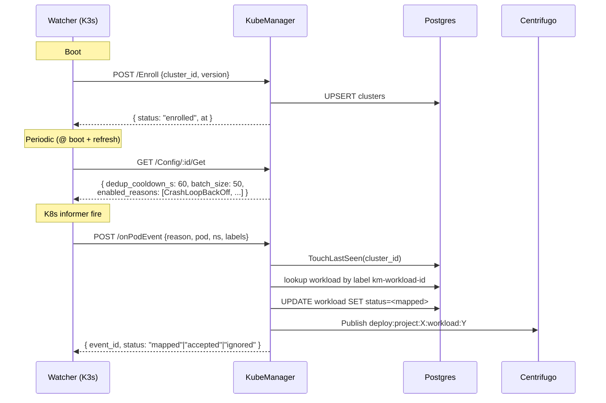

# Module `clusters`

> Enregistrement des clusters K8s distants + ingestion des pod events via le binaire `watcher` (projet séparé). Protocole Restate-compatible.

## Responsabilités

- Enroll d'un cluster au démarrage de son watcher.
- Fournir la config remote (dedup cooldown, batch size, enabled reasons K8s) au watcher.
- Ingérer chaque pod event significatif → update du workload + broadcast Centrifugo.
- Admin : lister les clusters enrollés + staleness (`LastSeenAt`).

## Endpoints HTTP

### Watcher protocol — sous `/kmanager/v1/clusters`

Groupe protégé par `RequireAPIKeyKind("cluster")` ([route.go:31](../../internal/infrastructure/router/route.go#L31)).

| Méthode | Chemin | Description |
|---------|--------|-------------|
| `POST` | `/ClusterService/Enroll` | Enregistrement au boot du watcher |
| `GET` | `/ConfigService/:clusterID/Get` | Config remote (dedup, reasons, batch) |
| `POST` | `/ProjectService/:clusterID/onPodEvent` | Un pod event reçu |

### Admin — sous `/kmanager/v1/admin/clusters`

Groupe protégé par `RequireGlobalRole(SUPER_ADMIN, ADMIN)` ([route.go:51](../../internal/infrastructure/router/route.go#L51)).

| Méthode | Chemin | Description |
|---------|--------|-------------|
| `GET` | `/admin/clusters` | Liste + LastSeenAt (monitoring staleness) |

## Table DB

| Table | Rôle |
|-------|------|
| `clusters` | cluster_id (unique), version, last_seen_at, enrolled_at |

Schéma : [migrations/000001_init.up.sql](../../migrations/000001_init.up.sql).

## Protocole watcher — 3 étapes



## Activities Temporal

Aucune. Toutes les opérations sont courtes et synchrones (quelques ms).

## Invariants critiques

1. **API key cluster obligatoire** — kind=`cluster`, scope `cluster:report`.
2. **Label workload** sur les pods K8s : `km-workload-id=<uuid>`. Posé automatiquement par le chart `standard-app` à travers `commonLabels.workloadID`.
3. **Idempotence côté serveur** : OnPodEvent doit être safe-retry. Le watcher dédup côté client (TTL `dedup_cooldown_seconds`) mais le serveur peut recevoir des doublons sur retry HTTP.
4. **TouchLastSeen** appelé à chaque OnPodEvent — sans ça, l'alerte `ClusterWatcherStale` peut déclencher à tort.
5. **Un seul watcher par cluster_id** (leader election via K8s Lease côté watcher). Si deux watchers s'enroll avec le même cluster_id, c'est un bug ops → détectable via duplicate last_seen patterns.

## Mapping reason K8s → status workload

```go
"CrashLoopBackOff"          → CRASHLOOP
"ImagePullBackOff"          → IMAGE_PULL_FAILED
"CreateContainerConfigError" → CONFIG_ERROR
"OOMKilled"                 → OOM_KILLED
"Failed"                    → FAILED
"Evicted"                   → EVICTED
```

Autres reasons → pas de mapping DB (status=`accepted` retourné, broadcast Centrifugo pour info UI).

## Config remote (defaults)

```json
{
  "dedup_cooldown_seconds": 60,
  "batch_size": 50,
  "batch_flush_ms": 1000,
  "enabled_reasons": [
    "CrashLoopBackOff", "ImagePullBackOff", "OOMKilled",
    "Evicted", "Failed", "Unhealthy"
  ]
}
```

Aujourd'hui hardcodé dans le service. Évolution prévue : table `clusters_config` par cluster.

## Pitfalls

- **Cluster jamais enrollé** → au premier OnPodEvent, `TouchLastSeen` échoue (row absente). On log + continue — le premier event ne doit pas être bloqué sur l'absence du Enroll, au cas où le watcher aurait raté son Enroll initial.
- **Label absent** → ignore. Le watcher peut voir des pods hors scope (kube-system, monitoring…). Normal.
- **Rotation cluster key** — l'ancienne clé reste valide `grace_days` jours (défaut 7). Le watcher doit piocher la nouvelle sinon 401 à l'expiration.
- **Changement de `cluster_id`** — impossible après Enroll (unique). Demande une migration manuelle (delete + ré-enroll).

## Tests

- [service_test.go](../../internal/modules/clusters/service_test.go) — Enroll (enrolled vs updated), GetConfig, OnPodEvent (happy, label absent, workload absent, reason mapped).

## Fichiers clés

- [entity.go](../../internal/modules/clusters/entity.go) — Cluster (GORM entity), DTOs (EnrollRequest, PodEvent, PodEventAck, RemoteConfigResponse).
- [service.go](../../internal/modules/clusters/service.go) — Enroll, GetConfig, OnPodEvent, ListClusters.
- [repository.go](../../internal/modules/clusters/repository.go) — ClusterRepository (Upsert, GetByClusterID, TouchLastSeen, List).
- [hclusters.go](../../internal/modules/clusters/hclusters.go) — controller.
- **Projet watcher séparé** : `betorun/watcher` — informers K8s + leader election + batching HTTP.

## Points d'attention ajout de feature

- Ajouter une `reason` K8s à traiter → map dans `reasonToWorkloadStatus` (dans le service) + mettre à jour `defaultRemoteConfig.EnabledReasons`.
- Sortir la config remote de son hardcode → créer la table `clusters_config` + endpoint admin pour la patcher.
- Nouveau champ sur `clusters` (région, cloud provider) → migration SQL + exposer dans ListClusters.
