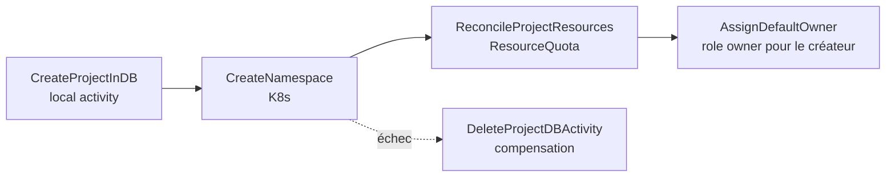
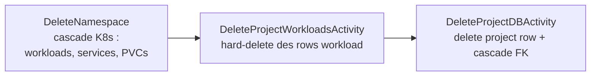

# Module `projects`

> Provisioning d'un projet = saga Temporal qui crée la row DB, le namespace K8s isolé, pose le ResourceQuota, et lie l'owner.

## Responsabilités

- CRUD projet (create, get, delete, status, metrics).
- Saga Temporal `CreateProjectWorkflow` : DB → namespace K8s → quota → owner.
- Saga Temporal `DeleteProjectWorkflow` : namespace → workloads DB → project DB.
- Lecture des metrics via le Metrics Server K8s (CPU/RAM/Storage par namespace).

## Endpoints HTTP

Sous `/kmanager/v1/projects`. Voir [route.go:128-134](../../internal/infrastructure/router/route.go#L128).

| Méthode | Chemin | Description |
|---------|--------|-------------|
| `POST` | `/` | Créer un projet (déclenche `CreateProjectWorkflow`) |
| `GET` | `/:id/status` | Statut DB + état K8s (namespace exists) |
| `GET` | `/:id/metrics` | CPU/RAM/Storage live (Metrics Server) + réservé (DB) |
| `DELETE` | `/:id` | Supprimer (déclenche `DeleteProjectWorkflow`) |

## Tables DB

| Table | Rôle |
|-------|------|
| `projects` | name, description, CPU/mem/storage limits, status, current_phase |
| `project_members` | user × project × role + status |

## Activities Temporal

### `CreateProjectWorkflow`

Fichier : [projects/workflows/create.go](../../internal/modules/projects/workflows/create.go).

**Compensation** : si `CreateNamespace` échoue après `CreateProjectInDB`, on rollback la row DB via `DeleteProjectDBActivity`. Les étapes suivantes (quota, owner) n'ont pas de compensation dédiée — si elles échouent, le projet reste en état `PROVISIONING` et peut être retry (ou delete manuel admin).

### `DeleteProjectWorkflow`

Fichier : [projects/workflows/delete.go](../../internal/modules/projects/workflows/delete.go).

Ordre **namespace first, DB second** — même logique que le delete workload. En cas d'échec à l'étape 1, on abort ; la DB reste cohérente et on peut retry.

## Invariants critiques

1. **Un projet = un namespace K8s unique** `km-<project-name>`. Le format est hardcodé — un project avec un `name` qui produirait un namespace K8s invalide (majuscules, underscore, > 63 chars) est refusé au niveau DTO.
2. **L'owner est toujours un `project_member`** avec `role=OWNER` et `status=ACTIVE`. Jamais d'orphelin.
3. **Toute modification projet qui touche K8s passe par une activity Temporal** — pas d'appel direct depuis le handler HTTP.
4. **Les secrets projet sont isolés par namespace** — jamais partagés cross-project.
5. **Le ResourceQuota s'applique au niveau namespace**. Si un workload demande plus que le quota restant → rejeté par le service.

## Pitfalls

- **Namespace orphelin** — si le workflow plante entre `CreateNamespace` et `ReconcileProjectResources`, le namespace existe sans quota. La saga n'auto-répare pas ça — un admin doit retry. À suivre dans Grafana "Projects in PROVISIONING state".
- **Delete race** — si un user POST un workload dans un project pendant que le delete workflow tourne, le workload peut être créé après la suppression du namespace → erreur à l'InstallChart. Atténuation : marquer le project `status=DELETING` avant le workflow (à faire — TODO si pas encore présent).
- **Name collision** — `projects.name` est `UNIQUE`. Les conflits renvoient 409 — le handler doit mapper proprement.

## Tests

- [service/create_test.go](../../internal/modules/projects/service/create_test.go) — CreateProject happy path, workflow error, DeleteProject not-found + happy.
- [workflows/create_test.go](../../internal/modules/projects/workflows/create_test.go) — saga happy + compensation.
- [workflows/delete_test.go](../../internal/modules/projects/workflows/delete_test.go) — saga ordonnée + abort si namespace échoue.

## Fichiers clés

- [domain/dto.go](../../internal/modules/projects/domain/dto.go) — CreateProjectRequest, ProjectResponse, NamespaceMetrics.
- [repository/repository.go](../../internal/modules/projects/repository/repository.go) — ProjectRepository (3 méthodes, dont la transaction CreateProject qui attache l'owner).
- [service/create.go](../../internal/modules/projects/service/create.go) — orchestration create + delete.
- [service/get.go](../../internal/modules/projects/service/get.go) — GetProjectStatus + GetMetrics (Metrics Server).
- [activities/db.go](../../internal/modules/projects/activities/db.go) — CreateProjectInDB, DeleteProjectDBActivity, DeleteProjectWorkloadsActivity.
- [activities/k8s.go](../../internal/modules/projects/activities/k8s.go) — CreateNamespace, DeleteNamespace, ReconcileProjectResources, AssignDefaultOwner.
- [workflows/](../../internal/modules/projects/workflows/) — create.go, delete.go.

## Points d'attention ajout de feature

- Nouvelle ressource projet-level (ex: NetworkPolicy par défaut, LimitRange) → ajouter une activity dans `activities/k8s.go` + l'appeler dans `CreateProjectWorkflow` entre `ReconcileProjectResources` et `AssignDefaultOwner`.
- Pour inverser l'ordre create (DB avant ou après namespace) → attention à la compensation ; toute activity avec effet externe doit avoir son inverse.
- Changer le format du namespace (`km-...`) nécessite une migration de tous les namespaces existants — pas une petite affaire.
