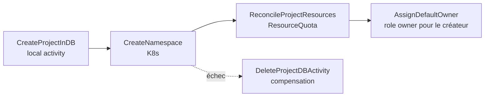
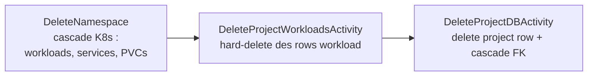

# Module `projects`

> Provisioning d'un projet = saga Temporal qui crée la row DB, le namespace K8s isolé, pose le ResourceQuota, et lie l'owner.

## Responsabilités

- CRUD projet (create, list, get, rename, delete, status, metrics).
- Plusieurs projets par organisation, dans la limite `organizations.max_projects` (3 par défaut, réglable par le staff).
- Limites de ressources : posées par défaut à la création, modifiées seulement par le staff (`PATCH /admin/projects/:id/limits`).
- Saga Temporal `CreateProjectWorkflow` : DB → namespace K8s → quota → owner.
- Saga Temporal `DeleteProjectWorkflow` : namespace → workloads DB → objets des sites → project DB (cascade : bases, membres, builds, sites…).
- Lecture des metrics via le Metrics Server K8s (CPU/RAM/Storage par namespace).

## Endpoints HTTP

Sous `/kmanager/v1`. Voir `addProjectRoutes` dans [route.go](../../internal/infrastructure/router/route.go).

| Méthode | Chemin | Permission | Description |
|---------|--------|-----------|-------------|
| `POST` | `/projects` | `resourcemanager.projects.create` sur l'organisation choisie (`organization_id`, vide = organisation personnelle) | Créer un projet (déclenche `CreateProjectWorkflow`), toujours avec les limites par défaut ; 409 `PROJECT_LIMIT_REACHED` au-delà du plafond, 409 si le nom existe déjà dans l'organisation ; `region` facultatif (voir `GET /regions`) : le projet est placé sur un cluster de cette région (409 `NO_CAPACITY_IN_REGION` sinon), voir [clusters.md](clusters.md#placement-des-projets-lot-2a) |
| `GET` | `/projects` | authentifié (filtré par les droits) | Projets accessibles (200 plus récents) + `organizations` : organisations où l'appelant peut créer, avec `projects` / `max_projects` |
| `GET` | `/projects/:id` | `resourcemanager.projects.get` | Résumé + limites |
| `PATCH` | `/projects/:id` | `resourcemanager.projects.update` | Renommer / changer la description (`{name?, description?}`) ; l'espace Kubernetes ne change pas |
| `GET` | `/projects/:id/status` | `resourcemanager.projects.get` | Statut DB + état K8s |
| `GET` | `/projects/:id/metrics` | `resourcemanager.projects.get` | Consommation live (Metrics Server), réservé, limites, images |
| `DELETE` | `/projects/:id` | `resourcemanager.projects.delete` (sensible) | Supprimer (déclenche `DeleteProjectWorkflow`) ; la console le propose sur la page Projet, nom à retaper |
| `PATCH` | `/admin/projects/:id/limits` | `platform.projects.setLimits` (staff, sensible) | Nouvelles limites `{cpu_limit, memory_limit, storage_limit}` ; un champ vide garde la valeur |
| `PATCH` | `/admin/organizations/:id/limits` | `platform.projects.setLimits` (staff, sensible) | Nombre de projets autorisés `{max_projects}` (1 à 1000) |

## Plusieurs projets

- **Plafond** : `organizations.max_projects` (défaut 3, migration 000043). Vérifié dans la transaction de création, sous verrou `FOR UPDATE` sur l'organisation : deux créations simultanées ne dépassent pas le plafond.
- **Nom** : libre (3 à 30 caractères, espaces de bord retirés, sans caractère de contrôle), unique par organisation sans tenir compte de la casse (`uq_projects_org_name`, projets non supprimés).
- **Console** : sélecteur dans la barre du haut, choix retenu par le navigateur (`kweb-current-project`) ; à défaut, le projet du bootstrap. Hook `useCurrentProject()`.
- **CLI** : `betorun projects list | create | use | rename` ; `use` écrit le projet par défaut dans les réglages (`--project` et `BETORUN_PROJECT` restent prioritaires).

## Limites et quota

- **À la création** : `DefaultProjectCPU` (`2000m`) et `DefaultProjectMemory` (`4Gi`) ([service/create.go](../../internal/modules/projects/service/create.go)). Le client ne choisit pas ses limites ; le bootstrap n'en accepte pas.
- **Changement (staff)** : [service/limits.go](../../internal/modules/projects/service/limits.go). Quantités Kubernetes positives, refusées sous ce que les conteneurs réservent déjà (`ErrLimitsBelowUsage`). La base est mise à jour d'abord (l'API s'y réfère pour accepter un déploiement), puis `UpdateProjectLimitsWorkflow` (ID `project-limits-<id>`, un seul à la fois) ajuste le ResourceQuota ; le rappeler avec les mêmes valeurs reprend un ajustement échoué.
- **Ce qui compte** : l'API refuse un déploiement qui dépasserait la limite. Comptent les conteneurs dans tous les états sauf supprimés (un conteneur en échec garde sa réservation), et pour le stockage les disques des bases.
- **ResourceQuota Kubernetes** : garde-fou posé avec une marge au-dessus de la limite (`withRollingMargin`), pour qu'une mise à jour progressive (un pod de plus pendant le déploiement) ne reste pas bloquée.

## Tables DB

| Table | Rôle |
|-------|------|
| `projects` | name, namespace, description, CPU/mem/storage limits, status, current_phase |
| `organizations.max_projects` | plafond de projets de l'organisation |
| `project_members` | user × project × role + status |

## Activities Temporal

### `CreateProjectWorkflow`

Fichier : [projects/workflows/create.go](../../internal/modules/projects/workflows/create.go).

**Compensation** : si `CreateNamespace` échoue après `CreateProjectInDB`, on rollback la row DB via `DeleteProjectDBActivity`. Les étapes suivantes (quota, owner) n'ont pas de compensation dédiée — si elles échouent, le projet reste en état `PROVISIONING` et peut être retry (ou delete manuel admin).

### `DeleteProjectWorkflow`

Fichier : [projects/workflows/delete.go](../../internal/modules/projects/workflows/delete.go).

Ordre **namespace first, DB second** — même logique que le delete workload. En cas d'échec à l'étape 1, on abort ; la DB reste cohérente et on peut retry.

## Invariants critiques

1. **Un projet = un namespace K8s unique**, stocké dans `projects.namespace` et lu partout depuis cette colonne. Nouveaux projets : `km-` + 12 premiers caractères hexadécimaux de l'ID (`utils.NewProjectNamespace`) ; projets d'avant la migration 000043 : `km-<nom>`, conservé. Le nom libre n'apparaît dans aucun objet Kubernetes (ni label ni annotation).
2. **L'owner est toujours un `project_member`** avec `role=OWNER` et `status=ACTIVE`. Jamais d'orphelin.
3. **Toute modification projet qui touche K8s passe par une activity Temporal** — pas d'appel direct depuis le handler HTTP.
4. **Les secrets projet sont isolés par namespace** — jamais partagés cross-project.
5. **Le ResourceQuota s'applique au niveau namespace**. Si un workload demande plus que le quota restant → rejeté par le service.

## Pitfalls

- **Namespace orphelin** — si le workflow plante entre `CreateNamespace` et `ReconcileProjectResources`, le namespace existe sans quota. La saga n'auto-répare pas ça — un admin doit retry. À suivre dans Grafana "Projects in PROVISIONING state".
- **Delete race** — `DeleteProject` ne passe pas le projet en `DELETING` en base (seule la réponse 202 le dit). Un workload créé pendant la suppression peut l'être après celle du namespace → erreur à l'InstallChart. Effet de bord connu : `GET /identity/bootstrap-status` garde le projet jusqu'à la dernière étape ; la console attend donc la fin (écran « Suppression du projet en cours »).
- **Name collision** — unique par organisation (`uq_projects_org_name`), 409 `ErrNameTaken`. Le namespace étant tiré de l'ID, recréer un projet du même nom juste après une suppression ne heurte pas l'ancien namespace.
- **Renommer** ne touche ni le namespace ni les adresses : seul l'affichage change.

## Tests

- [service/create_test.go](../../internal/modules/projects/service/create_test.go) — CreateProject happy path, workflow error, DeleteProject not-found + happy.
- [service/manage_test.go](../../internal/modules/projects/service/manage_test.go) — nom nettoyé, renommage, plafond, réglage staff.
- [workflows/create_test.go](../../internal/modules/projects/workflows/create_test.go) — saga happy + compensation.
- [workflows/delete_test.go](../../internal/modules/projects/workflows/delete_test.go) — saga ordonnée + abort si namespace échoue.

## Fichiers clés

- [domain/dto.go](../../internal/modules/projects/domain/dto.go) — CreateProjectRequest, ProjectResponse, NamespaceMetrics.
- [repository/repository.go](../../internal/modules/projects/repository/repository.go) — ProjectRepository (3 méthodes, dont la transaction CreateProject qui attache l'owner).
- [service/create.go](../../internal/modules/projects/service/create.go) — orchestration create + delete.
- [service/get.go](../../internal/modules/projects/service/get.go) — GetProjectStatus + GetMetrics (Metrics Server).
- [activities/db.go](../../internal/modules/projects/activities/db.go) — CreateProjectInDB, DeleteProjectDBActivity, DeleteProjectWorkloadsActivity.
- [activities/k8s.go](../../internal/modules/projects/activities/k8s.go) — CreateNamespace, DeleteNamespace, ReconcileProjectResources, AssignDefaultOwner.
- [service/limits.go](../../internal/modules/projects/service/limits.go) — SetLimits (staff).
- [service/manage.go](../../internal/modules/projects/service/manage.go) — GetProject, UpdateProject, OrganizationQuotas, SetMaxProjects.
- [workflows/](../../internal/modules/projects/workflows/) — create.go, delete.go, limits.go.

## Points d'attention ajout de feature

- Nouvelle ressource projet-level (ex: NetworkPolicy par défaut, LimitRange) → ajouter une activity dans `activities/k8s.go` + l'appeler dans `CreateProjectWorkflow` entre `ReconcileProjectResources` et `AssignDefaultOwner`.
- Pour inverser l'ordre create (DB avant ou après namespace) → attention à la compensation ; toute activity avec effet externe doit avoir son inverse.
- Changer le format du namespace ne touche que les nouveaux projets : les existants gardent la valeur de `projects.namespace`.
