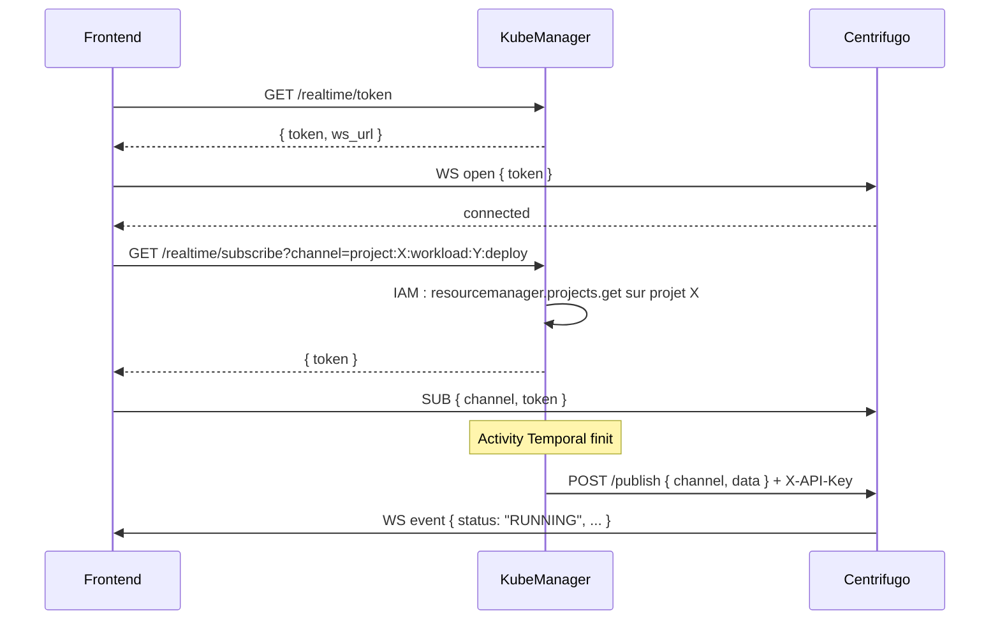

# Module `realtime`

> Émission de JWT Centrifugo HS256 pour le WebSocket frontend, plus un Publisher HTTP API pour broadcaster les events serveur → client.

## Responsabilités

- Émettre un **connection token** (TTL 1 h) pour qu'un user ouvre une WS Centrifugo.
- Émettre un **subscription token** (TTL 10 min) scopé à un canal, après vérification IAM de `resourcemanager.projects.get` sur le projet du canal.
- Publier des events depuis le backend (activities Temporal, service `clusters`, Recoverer des workloads) vers Centrifugo via son HTTP API (`POST /publish`).

## Endpoints HTTP

Sous `/kmanager/v1/realtime`. Voir `addRealtimeRoutes` dans [route.go](../../internal/infrastructure/router/route.go). Les deux routes sont `Authenticated()` (pas de garde `g.Perm` : le projet est dans le nom du canal, le contrôleur interroge l'IAM).

| Méthode | Chemin | Description | Auth |
|---------|--------|-------------|------|
| `GET` | `/token` | Connection token JWT HS256 (TTL 1 h) | utilisateur authentifié |
| `GET` | `/subscribe?channel=...` | Subscription token scopé (TTL 10 min) | utilisateur authentifié + `resourcemanager.projects.get` sur le projet du canal |

## Table DB

Aucune.

## Activities Temporal

Aucune. Mais le **Publisher** est injecté dans les activities DB du module `workloads` (transitions de statut), dans le service `clusters` (événements de pods) et dans le Recoverer des workloads.

## Flow end-to-end



## Channels — convention de nommage

| Channel | Usage |
|---------|-------|
| `project:<id>:events` | Dashboard projet, liste workloads |
| `project:<id>:workload:<id>` | Détails workload |
| `project:<id>:workload:<id>:deploy` | Transitions de statut (deploy / scale / delete), événements de pods du watcher |

Helpers dans [infrastructure/realtime/publish.go](../../internal/infrastructure/realtime/publish.go) (formats dans `constants.go`) :

```go
realtime.ProjectChannel(projectID)              // project:X:events
realtime.WorkloadChannel(projectID, workloadID) // project:X:workload:Y
realtime.DeploymentChannel(projectID, workloadID) // project:X:workload:Y:deploy
```

## Invariants critiques

1. **Secret HMAC identique** côté Centrifugo (`CENTRIFUGO_TOKEN_HMAC_SECRET_KEY`) et côté kubemanager (`KUBEMANAGER_CENTRIFUGO_TOKEN_HMAC_SECRET`). Sinon Centrifugo rejette tous les tokens.
2. **API key Centrifugo séparée du secret HMAC** — deux rôles distincts (publish vs sign).
3. **Subscription token toujours scopé** à un channel + `resourcemanager.projects.get` vérifié par l'IAM pour le **principal IAM** de l'appelant (identifiant interne, pas celui de l'annuaire) avant signature. Refus uniforme « not a member of this project » (n'indique pas si le projet existe).
4. **Connection token seul n'autorise PAS à subscribe** — Centrifugo refuse la sub sans subscription token.
5. **Publisher fail-open** : l'échec d'un `Publish` est loggé mais JAMAIS remonté. Ne doit pas casser une saga Temporal.

## TokenSigner (HS256)

Implémentation maison (pas de lib externe) : [infrastructure/realtime/token.go](../../internal/infrastructure/realtime/token.go).

```
Header    : {"alg":"HS256","typ":"JWT"}
Payload   : {sub, exp, info?}            ← connection token
          ou {sub, channel, exp}          ← subscription token
Signature : HMAC-SHA256(secret, base64url(header) + "." + base64url(payload))
```

## Publisher (HTTP API)

[infrastructure/realtime/publish.go](../../internal/infrastructure/realtime/publish.go).

```go
type Publisher interface {
    Publish(ctx context.Context, channel string, data any) error
}
```

- POST `{APIURL}/publish` avec header `X-API-Key`.
- Timeout 5 s.
- Fail-open : erreur loggée, jamais remontée.

Implémentations :
- `httpPublisher` — live Centrifugo (prod).
- `noopPublisher` — si Centrifugo disabled.

## Pitfalls

- **Fuite secret HMAC** — le secret ne doit jamais être dans les logs. Pas de `%v` sur la config complète.
- **TTL trop long** — connection token 1 h est un compromis. Si un user est révoqué, son WS reste up jusqu'à l'expiration. Acceptable en l'état ; à raccourcir si audit plus strict.
- **Channel injection** — le `channel` query param est parsé (`parseProjectIDFromChannel`) et le `project_id` extrait ; tout canal qui ne commence pas par `project:<uuid>` est refusé (400).
- **Publisher latency** — le `POST /publish` bloque le caller jusqu'à 5 s si Centrifugo est down. L'activity Temporal ne remonte pas l'erreur mais le caller attend quand même. Pour optimiser : passer en fire-and-forget avec un channel Go interne (TODO si devient un problème).

## Tests

- [hrealtime_test.go](../../internal/modules/realtime/hrealtime_test.go) — abonnement vérifié avec le principal IAM (identifiant interne), pas l'identifiant de l'annuaire.
- Le parsing des canaux et `buildWSURL` n'ont pas de test dédié.
- Le TokenSigner n'a pas de test unitaire dédié — à ajouter si on touche à la signature.

## Fichiers clés

- [hrealtime.go](../../internal/modules/realtime/hrealtime.go) — controller.
- [infrastructure/realtime/token.go](../../internal/infrastructure/realtime/token.go) — TokenSigner HS256.
- [infrastructure/realtime/publish.go](../../internal/infrastructure/realtime/publish.go) — Publisher + channel helpers.

## Config & env vars

Struct `configs.CentrifugoConfig` ([configs/config.go](../../internal/core/configs/config.go)) :

| Champ | Env var |
|-------|---------|
| `Enabled` | `KUBEMANAGER_CENTRIFUGO_ENABLED` |
| `URL` | `KUBEMANAGER_CENTRIFUGO_URL` |
| `APIURL` | `KUBEMANAGER_CENTRIFUGO_API_URL` |
| `APIKey` | `KUBEMANAGER_CENTRIFUGO_API_KEY` |
| `TokenHMACSecret` | `KUBEMANAGER_CENTRIFUGO_TOKEN_HMAC_SECRET` |
| `AllowedOrigins` | `KUBEMANAGER_CENTRIFUGO_ALLOWED_ORIGINS` |

Config Centrifugo côté broker (docker-compose) : **attention au suffixe `_KEY`** sur `CENTRIFUGO_TOKEN_HMAC_SECRET_KEY`.

## Points d'attention ajout de feature

- Nouveau channel → ajouter un helper dans `publish.go` pour éviter la duplication + normaliser le format.
- Changer le TTL → modifier les constantes `connectionTokenTTL` / `subscriptionTokenTTL` de [hrealtime.go](../../internal/modules/realtime/hrealtime.go) + mettre à jour [glossaire](../onboarding/04-glossaire.md).
- Nouveau provider realtime (ex: migration vers un autre broker) → refactor via l'interface `Publisher` + `TokenSigner`, tout le reste est découplé.
