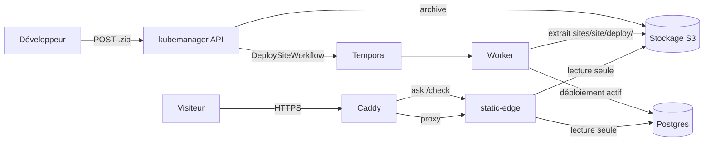

# Module `sites`

> Hébergement de sites statiques : upload d'un `.zip`, fichiers dans un stockage S3, servis par le binaire séparé `static-edge` derrière Caddy, sur `<sous-domaine>.<base_domain>` et sur des domaines personnalisés vérifiés.

## Architecture



- **API + worker** (`cmd/gateway`) : gestion des sites, upload, extraction (workflow Temporal), domaines.
- **`static-edge`** (`cmd/static-edge`) : binaire séparé exposé à Internet. Pas de config globale, de Temporal, de Kubernetes ni de Keycloak. Accès **lecture seule** à Postgres (`sites`, `site_domains`) et au stockage.
- **Caddy** : TLS. Wildcard `*.<base_domain>` par challenge DNS ; domaines perso en TLS à la demande, autorisés uniquement si `static-edge` répond 200 sur `/check` (port interne). Voir [docker/caddy/Caddyfile.prod.example](../../docker/caddy/Caddyfile.prod.example).

## Endpoints HTTP

Sous `/kmanager/v1/projects/:id/sites` (`:id` = projet). Chaque groupe est protégé par `RequireProjectPermission`.

| Méthode | Chemin | Permission | Description |
|---------|--------|-----------|-------------|
| `GET` | `/` | `project:view` | Lister les sites |
| `GET` | `/:siteID` | `project:view` | Détails + URL publique |
| `GET` | `/:siteID/deployments` | `project:view` | Historique (50 derniers) |
| `GET` | `/:siteID/domains` | `project:view` | Domaines personnalisés + cible CNAME |
| `POST` | `/` | `k8s:workload:create` | Créer un site `{name, subdomain?, spa_fallback}` |
| `PATCH` | `/:siteID` | `k8s:workload:create` | Modifier `spa_fallback` |
| `POST` | `/:siteID/deployments` | `k8s:workload:create` | Upload multipart, champ `archive` (.zip) → 202 |
| `POST` | `/:siteID/deployments/:deploymentID/activate` | `k8s:workload:create` | Rollback vers un déploiement `READY` |
| `POST` | `/:siteID/domains` | `k8s:workload:create` | Ajouter un domaine `{hostname}` |
| `POST` | `/:siteID/domains/:domainID/verify` | `k8s:workload:create` | Vérifier le DNS |
| `DELETE` | `/:siteID` | `k8s:workload:delete` | Supprimer (workflow : fichiers puis DB) |
| `DELETE` | `/:siteID/domains/:domainID` | `k8s:workload:delete` | Retirer un domaine |

```sh
curl -X POST -H "Authorization: Bearer $TOKEN" \
  -F archive=@site.zip \
  http://localhost:8080/kmanager/v1/projects/$PROJECT/sites/$SITE/deployments
```

## Tables DB

[migrations/000002_sites.up.sql](../../migrations/000002_sites.up.sql) : `sites`, `site_deployments`, `site_domains`.

## Stockage

| Clé | Contenu |
|-----|---------|
| `uploads/<site>/<deploy>.zip` | archive reçue, supprimée après extraction |
| `sites/<site>/<deploy>/<chemin>` | fichiers d'un déploiement |

Le préfixe est construit des deux côtés : `domain.ObjectPrefix` (API) et `edge.Site.Prefix` (edge). Les deux doivent rester identiques.

## Workflows Temporal

- **`DeploySiteWorkflow`** : `ExtractDeployment` → `MarkDeploymentReady` (active le déploiement), puis `DeleteArchive`. En cas d'échec : `MarkDeploymentFailed` avec un message lisible si l'archive est invalide, générique sinon. Le déploiement actif précédent continue d'être servi.
- **`DeleteSiteWorkflow`** : le site passe d'abord en `DELETING` (l'edge arrête de le servir), puis `DeleteSiteObjects`, puis `DeleteSiteRecord`.
- **Suppression d'un projet** : `DeleteProjectWorkflow` appelle `DeleteProjectSiteObjects` (sites en `DELETING` + fichiers supprimés) **avant** de supprimer le projet. Les lignes `sites` partent ensuite en cascade.

## Invariants critiques

1. **Zip-slip** : les chemins absolus ou contenant `..` font refuser l'archive entière, avant toute écriture.
2. **Limites** : 100 Mio d'archive, 500 Mio décompressés, 10 000 fichiers (`sites.*` dans la config), vérifiées sur l'en-tête **et** à la lecture.
3. **`index.html` obligatoire** à la racine. Un dossier racine unique (`dist/`) est retiré automatiquement.
4. **Domaine perso servi seulement si vérifié** : CNAME vers `edge_target` ou le sous-domaine du site, ou (apex) toutes ses IP égales à celles de l'edge. Sans ça, n'importe qui pourrait capter un domaine et faire émettre des certificats.
5. **L'edge ne sert que** les sites `LIVE` avec un déploiement actif. Cache nom d'hôte → site de 10 s : un déploiement est visible au plus 10 s après son activation. Le HTML est servi avec `max-age=0, must-revalidate`, le reste avec 1 h de cache.
6. **Identifiants de l'edge en lecture seule** (stockage et DB). En dev : identité `edge` de [docker/seaweedfs/s3.json](../../docker/seaweedfs/s3.json).

## Service des fichiers (edge)

`/` → `index.html` ; `/docs` → 301 vers `/docs/` si `docs/index.html` existe ; `/about` → `about.html` ; sinon `index.html` si `spa_fallback`, sinon le `404.html` du site, sinon une 404 bilingue. `Range`, `ETag` et `If-None-Match` sont gérés.

## Dev local

`make dev-up` lance `seaweedfs` (S3, port 8333), `static-edge` et `caddy` (port 8088). Une fois un site déployé : <http://SOUS-DOMAINE.sites.localhost:8088> (les navigateurs résolvent `*.localhost`).

## Prod — à préparer

- Rôle Postgres en lecture seule pour l'edge :
  ```sql
  CREATE ROLE edge_reader LOGIN PASSWORD '…';
  GRANT SELECT ON sites, site_domains TO edge_reader;
  ```
- Identifiants S3 en lecture seule sur le bucket.
- Caddy compilé avec le module DNS du fournisseur pour le wildcard.
- Templates du chart Helm pour `static-edge` + Caddy (pas encore écrits).

## Tests

- [activities/archive_test.go](../../internal/modules/sites/activities/archive_test.go) : zip-slip, limites, dossier racine, fichiers parasites.
- [service/verify_test.go](../../internal/modules/sites/service/verify_test.go) : vérification DNS.
- [workflows/workflows_test.go](../../internal/modules/sites/workflows/workflows_test.go) : saga, message utilisateur.
- [internal/edge/server_test.go](../../internal/edge/server_test.go) : résolution des chemins, SPA, 404, `/check`, cache.
- [e2e_test.go](../../internal/modules/sites/e2e_test.go) : vrai Postgres + S3, de l'upload au service (`SITES_E2E=1`, voir l'en-tête du fichier).
