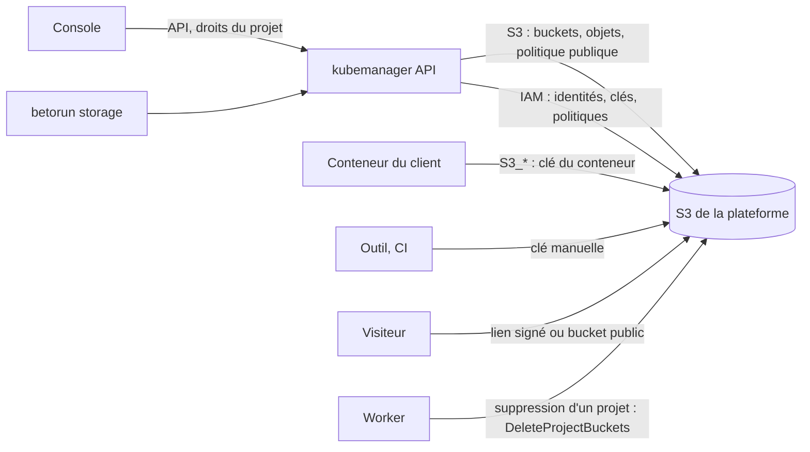

# Module `storages3`

> Stockage objet S3 par projet ([ADR 0015](../adr/0015-stockage-objet.md)) : des buckets aux noms S3 générés, une clé par usage limitée à un seul bucket, un quota qui passe le bucket en lecture et suppression au-delà, la lecture publique sur demande, des liens signés à durée limitée et un explorateur de fichiers dans la console. Côté client, on dit « stockage » : l'outil (SeaweedFS en V1) n'est jamais nommé.

## Architecture



- **Service** ([service/](../../internal/modules/storages3/service/)) : ne parle qu'à `service.Backend`. Un autre S3 (Ceph RGW, MinIO, fournisseur externe) peut s'y brancher sans toucher au reste ; chaque bucket garde son emplacement (`backend`).
- **Backend SeaweedFS** ([repository/s3.go](../../internal/modules/storages3/repository/s3.go), [objects.go](../../internal/modules/storages3/repository/objects.go), [iam.go](../../internal/modules/storages3/repository/iam.go)) : buckets et objets par l'API S3 (minio-go), identités par l'**API IAM intégrée** (protocole AWS, signée SigV4 service `iam`, même port). Identité d'administration dédiée (`storage`), jamais celle des sites. Le code refuse tout bucket qui ne commence pas par `bt-` (`guard`).
- **Relevé** : toutes les 15 min (`StartUsage`), espace occupé par bucket, quota appliqué, alertes à 80 % puis 100 % (module `alerts`, une fois par jour et par seuil au plus).
- **Console et CLI** parcourent les fichiers **par l'API**, avec l'identité du module : aucune clé client n'arrive dans le navigateur.

## Accès d'une clé

Chaque clé est une identité S3 propre (`btk-<id de la clé>`) avec une seule politique, posée selon l'état du bucket (`service.access`) :

| État | Clé `read_write` | Clé `read_only` |
|---|---|---|
| Normal | lire, lister, écrire, supprimer | lire, lister |
| Quota dépassé | lire, lister, **supprimer** (pour faire de la place) | lire, lister |
| Projet en délai de grâce | **aucun** | **aucun** |

« Aucun » : la SeaweedFS n'accepte que des politiques `Allow` ; une identité désactivée n'est autorisée que sur une ressource qui ne peut pas exister (`bt-disabled/none`, les noms générés n'ont que 12 lettres et chiffres). Vérifié sur un vrai S3 (`TestS3_E2E_Lot2`).

## Endpoints HTTP

Sous `/kmanager/v1/projects/:id/storage/buckets`. Déclarées dans `addStorageS3Routes` ([storages3_wiring.go](../../internal/infrastructure/router/storages3_wiring.go)) ; permission vérifiée sur `projects/<id>/buckets/<bucketID>`.

| Méthode | Chemin | Permission | Description |
|---|---|---|---|
| `GET` | `/` | `storage.buckets.list` | Buckets, espace, clés (jamais de secret) |
| `POST` | `/` | `storage.buckets.create` | Créer `{name, quota_gb}` (nom S3 généré) |
| `GET` | `/:bucketID` | `storage.buckets.get` | Détails |
| `PATCH` | `/:bucketID` | `storage.buckets.update` | Quota `{quota_gb}` : 1, 5, 10, 25, 50 ou 100 |
| `PUT` | `/:bucketID/public` | `storage.buckets.setPublic` (sensible) | Lecture publique `{public}` : lire un fichier par son adresse, lister refusé |
| `POST` | `/:bucketID/attach` | `storage.buckets.connect` + `workloads.variables.update` sur le conteneur | Clé propre au conteneur, variables posées, redéploiement |
| `POST` | `/:bucketID/keys` | `storage.buckets.connect` | Clé manuelle `{name, access}` ; secret montré une fois |
| `POST` | `/:bucketID/keys/:keyID/rotate` | `storage.buckets.connect` (+ variables du conteneur pour un branchement) | Nouveau secret ; branchement : posé puis redéployé avant la révocation de l'ancien |
| `DELETE` | `/:bucketID/keys/:keyID` | `storage.buckets.connect` | Révoquer (branchement : variables retirées) |
| `DELETE` | `/:bucketID?confirm=<nom>` | `storage.buckets.delete` (sensible) | Vide, ou confirmé par son nom : contenu effacé |
| `GET` | `/:bucketID/objects?prefix=&after=&limit=` | `storage.objects.list` | Un dossier, dossiers d'abord, par pages (`next`) |
| `GET` | `/:bucketID/objects/download?key=` | `storage.objects.get` | Téléchargement (toujours en pièce jointe, `nosniff`), inscrit au journal d'accès aux données |
| `POST` | `/:bucketID/objects?key=` | `storage.objects.create` | Envoi multipart (champ `file`, 100 Mo) ; clé terminée par `/` sans fichier : nouveau dossier ; refusé au-delà du quota |
| `POST` | `/:bucketID/objects/delete` | `storage.objects.delete` | `{keys}` ; une clé terminée par `/` efface tout le dossier |
| `POST` | `/:bucketID/objects/link` | `storage.objects.share` | Lien signé `{key, expires_hours}` (1 à 168 h) |

## Rôles

| Rôle | Stockage |
|---|---|
| Lecteur | voir les buckets, parcourir les fichiers |
| Développeur | + télécharger et envoyer des fichiers |
| Éditeur | + créer, quota, brancher, clés, supprimer et partager des fichiers |
| Propriétaire | + supprimer un bucket, lecture publique |
| `roles/storage.admin` | tout le stockage |
| `roles/storage.objectUser` | les fichiers seulement (parcourir, télécharger, envoyer, supprimer, partager) |

## Cycle de vie

- **Suppression d'un bucket** : clés d'abord (variables retirées des conteneurs), puis le bucket ; non vide, il faut confirmer par son nom.
- **Projet en délai de grâce** (`ProjectStorage` du service des projets) : clés désactivées, lecture publique fermée (le réglage est gardé), données intactes ; restauration : tout revient.
- **Purge d'un projet** : activité Temporal `DeleteProjectBuckets` dans `DeleteProjectWorkflow`, avant la suppression des lignes (la cascade n'efface ni les données ni les identités). Versionnée (`GetVersion`) : les suppressions déjà en cours rejouent sans elle.
- **Organisation suspendue puis purgée** (facturation) : `orgPurger` efface aussi les buckets.

## Facturation

Compteur `storage` : Go occupés au dernier relevé (arrondis au Go supérieur, comme les disques), prix mensuel au Go de la grille (`storage_gb_monthly`, 0 tant que l'équipe ne l'a pas fixé), à l'heure. Un bucket vide ne coûte rien ; rien n'est compté pendant le délai de grâce. Ligne de facture « Stockage objet ». Le trafic sortant n'est pas facturé en V1.

## CLI

```
betorun storage list | create <nom> [--quota 10] | quota <bucket> <go> | delete <bucket> [--purge]
betorun storage attach <bucket> <conteneur> [--prefix S3] [--read-only]
betorun storage keys list|create|rotate|revoke <bucket> …
betorun storage ls <bucket>[:<dossier>]
betorun storage cp ./fichier <bucket>:<chemin>   |   cp <bucket>:<chemin> . (ou - pour la sortie standard)
betorun storage rm <bucket>:<chemin>… [--yes]     (chemin terminé par / : tout le dossier)
betorun storage link <bucket>:<chemin> [--hours 24]
betorun storage public <bucket> on|off
```

## Configuration

`storage_s3` (`KUBEMANAGER_STORAGE_S3_*`) : `endpoint` (host:port, interne), `use_ssl`, `region`, `access_key`, `secret_key` (identité `storage`), `public_endpoint` (adresse donnée aux applications et aux liens : `https://s3.<domaine>`). Sans `endpoint`, le module répond « indisponible » (503) et la console masque la section.

La SeaweedFS démarre avec `-s3.iam.readOnly=false` (écriture des identités) et `-s3.iam.selfServiceRequiresGrant=true` (une clé client ne gère pas ses propres clés). En production, Caddy ouvre `s3.<domaine>` aux seuls chemins `/bt-<12 caractères>` (tout le S3, depuis partout) ; la liste des buckets, l'API IAM et les buckets de la plateforme restent fermés de l'extérieur. Adresses en **style chemin** (`forcePathStyle` dans les SDK).

## Essais

- `go test ./internal/modules/storages3/...` : service (doublures en mémoire).
- Sur un vrai S3 (SeaweedFS de dev ou jetable) : `STORAGE_S3_E2E=1 [STORAGE_S3_ENDPOINT=…] go test ./internal/modules/storages3/repository/ -run E2E -v` : isolation entre clés, liste des buckets, lecture seule, quota dépassé, désactivation, rotation, lecture publique (lire oui, lister non), liens signés, dossiers.

## Limites connues

- L'identité `storage` est administrateur de toute la SeaweedFS (la configuration statique ne sait pas limiter à `bt-*`) : la limite est dans le code (`guard`). Son secret ne quitte jamais l'API et le worker.
- Le relevé liste tous les objets d'un bucket (suffisant en V1 ; à remplacer par les statistiques du filer quand les buckets grossiront).
- Un dossier vidé fichier par fichier reste affiché (la SeaweedFS garde les dossiers) ; supprimer le dossier l'efface.
