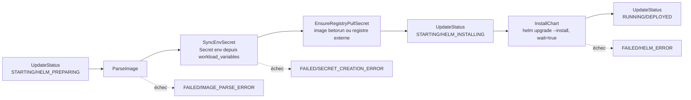
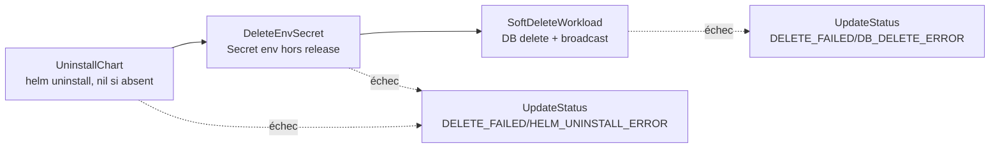

# Module `workloads`

> Lifecycle complet d'une application containerisée : deploy, scale, restart, rollback, logs, events, metrics, delete. Le cœur métier de la plateforme.

## Responsabilités

- API HTTP : CRUD, lifecycle K8s, domaines personnalisés, variables et secrets, duplication, observabilité (21 routes sous `/workloads`, plus 5 du module `github`).
- Deploy : quota check → DB row → saga `DeployWorkloadWorkflow` (SyncEnvSecret → EnsureRegistryPullSecret si besoin → InstallChart). Une mise à jour (`PATCH`, variables) relance le même workflow (identifiant `workload-update-<id>`).
- Delete : saga `DeleteWorkloadWorkflow` (UninstallChart → DeleteEnvSecret → SoftDeleteWorkload).
- Lifecycle direct (stop/start/restart/rollback) — appels K8s synchrones, sans Temporal.
- Observabilité : LiveStatus, Logs stream, Events, Metrics live.
- Récupération : passe périodique du worker (Recoverer) + `recoverOnRead`, surveillance des crons.

## Endpoints HTTP

Sous `/kmanager/v1/workloads`. Déclarées dans `addWorkloadRoutes` (et `addGitHubRoutes` pour `/:id/github`) de [route.go](../../internal/infrastructure/router/route.go). Chaque route porte sa permission IAM (`g.Perm`), vérifiée sur `projects/<projet>/workloads/<id>` (projet du corps pour la création, `?project_id` pour la liste).

### CRUD

| Méthode | Chemin | Permission | Description |
|---------|--------|-----------|-------------|
| `POST` | `/` | `workloads.workloads.create` | Déployer (saga) → 202 |
| `GET` | `/` | `workloads.workloads.list` | Lister par projet (`?project_id=...`) |
| `GET` | `/:id` | `workloads.workloads.get` | Détails DB |
| `PATCH` | `/:id` | `workloads.workloads.update` | Update image, variables, disque, répliques, port, limites, commande, horaire, `image_from`, `health_command`, `no_public_url`, délai de démarrage (nouveau déploiement) → 202 |
| `DELETE` | `/:id` | `workloads.workloads.delete` | Supprimer (saga) → 202 |
| `POST` | `/:id/duplicate` | `workloads.workloads.create` + `workloads.workloads.update` + `workloads.variables.update` (sur la source) | Dupliquer `{name}` → 202 |

### Lifecycle K8s (direct, pas de saga)

| Méthode | Chemin | Permission | Description |
|---------|--------|-----------|-------------|
| `POST` | `/:id/stop` | `workloads.workloads.stop` | Scale to 0 (cron : `suspend: true`) |
| `POST` | `/:id/start` | `workloads.workloads.start` | Scale back to N (cron : `suspend: false`) |
| `POST` | `/:id/restart` | `workloads.workloads.restart` | Rollout restart (cron : exécution immédiate, Job créé depuis le CronJob) |
| `POST` | `/:id/rollback` | `workloads.workloads.rollback` | Helm rollback |

### Domaines et variables

| Méthode | Chemin | Permission | Description |
|---------|--------|-----------|-------------|
| `GET` | `/:id/domains` | `workloads.domains.list` | Domaines et enregistrements DNS à créer |
| `POST` | `/:id/domains` | `workloads.domains.update` | Ajouter un domaine `{hostname, path?}` (web seulement ; rien n'est routé avant la preuve) → 201 |
| `POST` | `/:id/domains/:domainID/verify` | `workloads.domains.update` | Vérifier la preuve (TXT) et router le domaine |
| `DELETE` | `/:id/domains/:domainID` | `workloads.domains.update` | Retirer un domaine et sa route → 204 |
| `GET` | `/:id/variables` | `workloads.variables.list` | Variables et secrets (valeur d'un secret jamais renvoyée) |
| `PATCH` | `/:id/variables` | `workloads.variables.update` | `{env, secrets, unset}` en une fois (nouveau déploiement si une valeur change) |

### Observabilité

| Méthode | Chemin | Permission | Description |
|---------|--------|-----------|-------------|
| `GET` | `/:id/status` | `workloads.workloads.get` | LiveStatus (DB + runtime K8s) |
| `GET` | `/:id/events` | `workloads.workloads.get` | Events K8s filtrés |
| `GET` | `/:id/logs` | `workloads.logs.read` | Stream logs pod (chunked HTTP) |
| `GET` | `/:id/metrics` | `workloads.metrics.read` | CPU/RAM live (metrics-server) + réservé (DB) |

### Dépôt GitHub (module `github`)

| Méthode | Chemin | Permission | Description |
|---------|--------|-----------|-------------|
| `GET` | `/:id/github` | `workloads.workloads.get` | Dépôt lié, dernier commit déployé, dernier build |
| `PUT` | `/:id/github` | `workloads.github.manage` | Lier à un dépôt (ou remplacer le lien) |
| `PATCH` | `/:id/github` | `workloads.github.manage` | Branche, sous-dossier, Dockerfile, déploiement à chaque push |
| `DELETE` | `/:id/github` | `workloads.github.manage` | Supprimer le lien (le conteneur continue de tourner) |
| `POST` | `/:id/github/deploy` | `workloads.workloads.update` | Construire et déployer le dernier commit de la branche suivie → 202 |

### Disque

Agrandir le disque d'un conteneur : `GET|POST /workloads/:id/disk`, par copie (le stockage `local-path` ne s'agrandit pas). Voir [diskresize](diskresize.md). `PATCH /workloads/:id` refuse désormais un autre `storage_size` sur un conteneur à disque.

## Sortes de conteneur (`kind`)

Colonne `workloads.kind` (migration 000028), **immuable** après la création. Règles dans [domain/kind.go](../../internal/modules/workloads/domain/kind.go) (`NormalizeProcess`).

| Sorte | Objet K8s | Port / Service / Ingress / sondes HTTP | Notes |
|-------|-----------|----------------------------------------|-------|
| `web` (défaut) | Deployment | oui (port 8080 par défaut) | domaines personnalisés possibles ; sondes HTTP sur `health_path` / `readiness_path` (défaut `/`) |
| `worker` | Deployment | non | processus continu (file d'attente, bot) ; sonde facultative `health_command` |
| `cron` | CronJob | non | `schedule` obligatoire, `time_zone` IANA, `max_duration_seconds` (défaut 3600, ≤ 86400) ; 1 réplique, ni HPA ni PDB |

- `command` / `args` remplacent l'ENTRYPOINT / le CMD de l'image (toutes sortes) : même image pour le web, le worker et le cron. Ils sont renvoyés dans `LiveStatus.command` / `args` (vides : ceux de l'image) et modifiables par `PATCH /workloads/:id` (`command: []` : retour à celle de l'image ; nouveau déploiement), y compris depuis la console (carte « Démarrage »).
- Chart : le gabarit de pod est commun (`_pod.tpl`) ; `deployment.yaml` hors cron, `cronjob.yaml` pour le cron (`concurrencyPolicy: Forbid`, `backoffLimit: 0`, `restartPolicy: Never`, `ttlSecondsAfterFinished` 1 j). `suspend` est rendu depuis le statut (STOPPED) : une mise à jour ne réactive pas un cron arrêté.
- Cron, côté service ([service/cron.go](../../internal/modules/workloads/service/cron.go)) : `LiveStatus.cron` (horaire, suspendu, exécutions en cours, dernière exécution, dernier succès) ; les journaux montrent le pod le plus récent ; `revisionBehind` lit l'annotation `checksum/env` du gabarit du CronJob.
- Surveillance des crons ([service/recover.go](../../internal/modules/workloads/service/recover.go), `SweepCrons`, chaque minute) : un cron RUNNING dont le **dernier Job** (planifié ou manuel, même image que le conteneur) est `Failed` passe `RUN_FAILED`, phase `POD_<raison>` (`BackoffLimitExceeded`, `DeadlineExceeded`…), avec alerte email aux owners. Le watcher ne peut pas le signaler : un Job échoué ne laisse qu'un pod terminé. Le Recoverer remet RUNNING dès que le dernier Job réussit. Un Job d'une image précédente est ignoré (un redéploiement ne réveille pas un ancien échec).
- RBAC de l'API : `batch/cronjobs` (deploy/k8s/rbac.yaml).
- Clients : CLI `--kind --command --schedule --timezone --max-duration`, `betorun workloads run <nom>` ; `betorun.yaml` (`kind`, `command`, `args`, `schedule`, `timezone`, `max_duration`) ; MCP `deploy` (`kind`, `command`, `schedule`, `time_zone`) ; Copilot `create_workload`.

## Variables et secrets

Table `workload_variables` (migration 000018) : une ligne **chiffrée** par nom (clé hors base), drapeau `secret`. C'est la source de vérité du Secret Kubernetes `<nom>-env`, que le worker écrit (`SyncEnvSecret`) ; les workflows ne transportent que `env_revision`, jamais une valeur (rien dans l'historique Temporal). Une valeur secrète ne se relit jamais, elle se remplace (`GET /:id/variables` la renvoie vide). `PATCH /:id/variables` `{env, secrets, unset}` applique tout en une fois (un seul redéploiement, refusé si un déploiement est en cours). Limites : 200 variables, 64 Kio par valeur, 768 Kio au total ([domain/variables.go](../../internal/modules/workloads/domain/variables.go)). Le Copilot ne pose jamais de secret.

## Réseau privé du projet

Les conteneurs d'un même projet se joignent directement ([network-policy.yaml](../../internal/infrastructure/helm/charts/standard-app/templates/network-policy.yaml), `networkPolicy.projectNetwork`) : une règle d'entrée et une règle de sortie (la sortie Internet exclut les adresses privées) vers les pods du même espace portant `app.kubernetes.io/part-of: kubemanager` et le même `km-project-id`, tous ports. Un autre projet est dans un autre espace : jamais visé. Sans identifiant de projet, aucune règle (un label vide viserait tout).

Vue du client : `GET /projects/:id/network` ([network.md](network.md)), indépendante du système qui applique les règles.

Adresse interne d'un conteneur web : `http://<nom>` (Service, port 80 ; les conteneurs d'un projet partagent son espace, le nom court suffit, la forme longue `http://<nom>.<espace>.svc` marche aussi), renvoyée par `LiveStatus.internal_url` et affichée par la CLI et la console. Worker et cron n'en ont pas. Un conteneur existant reçoit les règles à son prochain déploiement.

## Retours du test Bomba (19/11)

- **Déploiement en délai dépassé** : un conteneur `FAILED` / `HELM_ERROR` dont les pods finissent par démarrer (application lente) repasse `RUNNING` par la passe de récupération, à condition que le Deployment porte la version voulue (image et révision des variables) ; sinon l'échec reste.
- **Délai de démarrage** : `startup_timeout_seconds` (création, mise à jour, GitHub, console, `betorun.yaml` `startup_timeout`), 10 à 600 s, défaut 150 s (0 = défaut) ; règle le seuil de la sonde de démarrage (essais de 5 s).
- **Événements** : date prise dans `FirstTimestamp`, sinon `EventTime`, sinon la création de l'objet (les événements récents du planificateur laissaient « 1 janv. 1 »).
- **Échec démenti à la lecture** : `GET /:id/status` lève aussi un `FAILED` / `HELM_ERROR` quand la version voulue tourne entièrement (`recoverOnRead`, même écriture conditionnelle que la passe du worker) : « Échec » ne reste plus affiché à côté de « Prêts 1/1 ».
- **Dupliquer** : `POST /:id/duplicate` `{name}` (permissions `workloads.workloads.create`, `workloads.workloads.update`, `workloads.variables.update` sur la source). Même image et même spec ; variables et secrets recopiés côté serveur ([service/duplicate.go](../../internal/modules/workloads/service/duplicate.go)). Ni domaines ni données du disque. Console : menu du conteneur, « Dupliquer ».
- **Suivre l'image d'un autre conteneur** : `image_from` (spec, création et `PATCH` ; `betorun.yaml` `image_from`). Chaque nouvelle image de la source (build, `PATCH image`) est déployée sur les conteneurs qui la suivent (un niveau, suiveurs arrêtés ou occupés passés et journalisés). Un `betorun.yaml` avec seulement `image_from` reprend l'image actuelle de la source : le worker de l'API n'a plus de build propre.
- **Sonde d'un worker** : `health_command` (worker seulement ; `betorun.yaml` `health_command`, console « Commande de santé »). Sondes `exec` de démarrage et de vivacité (pas de readiness : aucun trafic) ; code 0 = sain.
- **Adresse publique automatique facultative** : `no_public_url` (création, `PATCH`, console, `betorun.yaml` `public_url: false`) : pas d'hôte sslip.io ; les domaines vérifiés restent routés (même classe d'ingress).
- **Quota** : la place réservée compte tous les conteneurs sauf `DELETED` (un déploiement en délai dépassé garde ses pods).

## Domaines personnalisés

Les TXT sont lus par des résolveurs publics (`kubernetes.domain_dns_server`, défaut `1.1.1.1:53,8.8.8.8:53` ; `system` pour celui de la machine, sujet au cache négatif : une preuve lue avant sa création restait « introuvable » jusqu'à 30 min). Un échec de lecture est journalisé. Un domaine se prouve par un TXT `_betorun-challenge.<nom>` propre à la demande, puis pointe vers la plateforme (A, CNAME ou ALIAS). Rien n'est routé avant la preuve ([service/domains.go](../../internal/modules/workloads/service/domains.go)).

- **Chemin** (migration 000029) : une route = nom + chemin (`/` par défaut). Plusieurs conteneurs d'un même projet partagent un nom, un chemin chacun (ex. `/auth` vers Keycloak, `/` vers le site) ; Traefik sert la règle la plus longue. Une route vérifiée n'a qu'un conteneur (`UNIQUE (hostname, path) WHERE verified`). Un nom déjà demandé dans le projet (prouvé, ou encore en attente) transmet son jeton aux nouveaux chemins : un seul TXT. Un autre projet garde le nom tant que sa preuve est en place ; sinon toutes ses routes tombent (changement de mains). L'application doit savoir servir sous son préfixe (pas de réécriture).
- **Enregistrements** : chaque enregistrement porte `name` (complet) et `host` (relatif à la zone, `@` au sommet ; zone = domaine enregistré, liste des suffixes publics). Sous-domaine : CNAME si la cible (`kubernetes.ingress_target`) est un nom, A si c'est une IP. Domaine nu : A vers les adresses IPv4 de la cible, plus un ALIAS proposé `alternative` (le fournisseur suit alors un changement d'adresse). Recommandé : une cible par nom, pour qu'un changement d'IP ne demande rien aux clients en sous-domaine.
- **Fournisseur DNS** : reconnu par les serveurs NS de la zone (`dns_provider` : cloudflare, ovh, godaddy, namecheap, gandi, google, route53, ionos, hostinger, lws…) ; la console et la CLI affichent le guide correspondant.
- Chart : un Ingress et un certificat par route (`customDomains` = `{host, path}`) ; une route `/` garde le nom d'Ingress d'avant les chemins.
- **Diagnostic** : la réponse de « Vérifier » porte `check` (résolveurs interrogés, nom lu, valeurs TXT trouvées — 5 au plus —, preuve trouvée, cause d'un échec : NXDOMAIN, délai). Chaque réponse porte `https` (faux : plateforme sans certificat, la console le signale).

## Table DB

| Table | Rôle |
|-------|------|
| `workloads` | project_id, name, namespace, chart, version, image, kind, status, phase, replicas, resources, network, storage, labels, env_revision |
| `workload_variables` | variables et secrets chiffrés (voir plus haut) |
| `workload_domains` | domaines personnalisés : nom, chemin, jeton de preuve, vérification |
| `workload_git_links` | lien vers un dépôt GitHub (module `github`) |

## Activities Temporal

### `DeployWorkloadWorkflow`

Fichier : [workloads/workflows/deployWorkload.go](../../internal/modules/workloads/workflows/deployWorkload.go).



**Compensation** : pas de rollback automatique. Le workload reste en DB avec `status=FAILED` — l'utilisateur fait un DELETE ou retry manuel. L'état final est écrit sur un contexte détaché (même après annulation) et ne remplace jamais `DELETING`. Un `FAILED` / `HELM_ERROR` dont la version voulue finit par tourner repasse `RUNNING` (Recoverer, `recoverOnRead`).

### `DeleteWorkloadWorkflow`

Fichier : [workloads/workflows/deleteWorkload.go](../../internal/modules/workloads/workflows/deleteWorkload.go).



Design **"Helm first, DB second"** — minimise les orphelins K8s si la DB échoue (vaut mieux avoir une row en DELETE_FAILED qu'une release Helm orpheline dans K8s).

## Invariants critiques

1. **Saga Delete : Helm uninstall AVANT soft-delete DB**. Inverser = risque d'orphelin K8s.
2. **Idempotence** : `InstallChart` et `UninstallChart` passent par `idempotency.ExecuteActivity()` (TTL 10 min pour l'installation, 5 min pour la désinstallation).
3. **Isolation** : un namespace par projet, `km-<nom du projet>` (`utils.ProjectNamespace`), jamais cross-project.
4. **Retry** : `UninstallChart` max 3x, timeout 5 min ; nil si release absente (safe retry).
5. **Publisher fail-open** : si Centrifugo plante, le broadcast est silencieusement dropped — ne casse jamais la saga.
6. **Port cible** : pas de liste de ports réservés (le port vit dans le network namespace du pod) ; 8080 par défaut (les images construites par betorun écoutent sur 8080) ; ports < 1024 refusés sauf 80 (`validateNetwork`).
7. **Quota checks** avant `Create(workload)` et à chaque mise à jour — sommes `CPULimit × Replicas`, `MemoryLimit × Replicas` et disques de tous les workloads du projet sauf `DELETED`, ne doivent pas dépasser les limites du projet (CPU, mémoire, stockage).

## Status DB possibles

```
(BUILDING →) STARTING → RUNNING | FAILED
                  ↓
            STOPPED, SCALING, DEGRADED
            incidents du watcher : CRASHLOOP, IMAGE_PULL_FAILED,
              CONFIG_ERROR, OOM_KILLED, EVICTED, FAILED
            cron : RUN_FAILED
                  ↓
            DELETING → DELETED | DELETE_FAILED
```

Constantes et phases : [utils/constants.go](../../internal/modules/utils/constants.go). `BUILDING` : conteneur créé depuis un dépôt, première image en construction. Restart et rollback laissent le conteneur `RUNNING` (phases `ROLLOUT_RESTART`, `ROLLED_BACK`).

## Pitfalls

- **Logs stream deadlock** — le handler `GetWorkloadLogs` écrit directement sur `c.Writer` via `io.Copy`. Si le client ferme la connexion, le stream doit fermer proprement. Aujourd'hui on utilise `wrapRawHandler` qui bypass tonic — ne pas essayer de le passer en tonic, ça casserait le streaming.
- **Orphan workload après delete project** — si un workload est créé pendant un delete project, il peut survivre. Voir pitfalls de [projects](projects.md).
- **quota stale** — le `GetTotalUsageByProject` lit la DB, pas le runtime K8s. Si un workload est `STOPPED` (0 replicas) ou `FAILED`, il compte quand même dans le quota (sa `replicas` est en DB). Voulu pour `FAILED` (un déploiement en délai dépassé garde ses pods) ; à valider pour `STOPPED`.

## Tests

- [service/update_test.go](../../internal/modules/workloads/service/update_test.go) — mise à jour, quotas, déploiement en cours, compensation.
- [service/recover_test.go](../../internal/modules/workloads/service/recover_test.go) — Recoverer, délai dépassé, `recoverOnRead`.
- [service/cron_test.go](../../internal/modules/workloads/service/cron_test.go), [service/domains_test.go](../../internal/modules/workloads/service/domains_test.go), [service/duplicate_test.go](../../internal/modules/workloads/service/duplicate_test.go), [service/network_test.go](../../internal/modules/workloads/service/network_test.go), [service/events_test.go](../../internal/modules/workloads/service/events_test.go).
- [domain/kind_test.go](../../internal/modules/workloads/domain/kind_test.go), [domain/variables_test.go](../../internal/modules/workloads/domain/variables_test.go), [domain/domains_dns_test.go](../../internal/modules/workloads/domain/domains_dns_test.go).
- [activities/db_test.go](../../internal/modules/workloads/activities/db_test.go) — UpdateWorkloadStatus (publisher fail-open, DB fail, nil publisher), SoftDeleteWorkload.
- [activities/heml_test.go](../../internal/modules/workloads/activities/heml_test.go), [activities/kinds_chart_test.go](../../internal/modules/workloads/activities/kinds_chart_test.go), [activities/domains_chart_test.go](../../internal/modules/workloads/activities/domains_chart_test.go) — values Helm et rendu du chart.
- [workflows/deployWorkload_test.go](../../internal/modules/workloads/workflows/deployWorkload_test.go) — saga deploy : succès, échec enregistré, image invalide, annulation, délais.

## Fichiers clés

- [domain/entity.go](../../internal/modules/workloads/domain/entity.go), [domain/dto.go](../../internal/modules/workloads/domain/dto.go) — modèle + DTOs.
- [repository/repo.go](../../internal/modules/workloads/repository/repo.go) — WorkloadRepository.
- [service/deploy.go](../../internal/modules/workloads/service/deploy.go) — Deploy, Update, parseurs CPU/mem.
- [service/lifecycle.go](../../internal/modules/workloads/service/lifecycle.go) — Get, List, Delete, Stop/Start/Restart/Rollback, LiveStatus, Logs, Events, Metrics.
- [service/domains.go](../../internal/modules/workloads/service/domains.go), [service/duplicate.go](../../internal/modules/workloads/service/duplicate.go), [service/cron.go](../../internal/modules/workloads/service/cron.go), [service/recover.go](../../internal/modules/workloads/service/recover.go), [service/network.go](../../internal/modules/workloads/service/network.go) — domaines, duplication, crons, récupération, réseau privé.
- [domain/kind.go](../../internal/modules/workloads/domain/kind.go), [domain/variables.go](../../internal/modules/workloads/domain/variables.go), [domain/domains.go](../../internal/modules/workloads/domain/domains.go) — règles des sortes, variables, domaines.
- [repository/variables.go](../../internal/modules/workloads/repository/variables.go), [repository/domains.go](../../internal/modules/workloads/repository/domains.go) — variables chiffrées, domaines.
- [service/interface.go](../../internal/modules/workloads/service/interface.go) — IWorkloadService (contrat complet).
- [activities/heml.go](../../internal/modules/workloads/activities/heml.go) — InstallChart, UninstallChart, SyncEnvSecret, DeleteEnvSecret, EnsureRegistryPullSecret, `buildHelmValues` (noter le typo "heml" historique).
- [activities/db.go](../../internal/modules/workloads/activities/db.go) — UpdateWorkloadStatus, SoftDeleteWorkload, broadcast Centrifugo.
- [workloads.go](../../internal/modules/workloads/workloads.go) — controller.

## Points d'attention ajout de feature

- Nouveau lifecycle (ex: "pause") → décider s'il passe par Temporal (si effet DB ou plusieurs systèmes) ou en direct (si 1 appel K8s atomique).
- Nouveau champ DTO → ajouter dans `CreateWorkloadRequest` (et `UpdateWorkloadRequest` s'il est modifiable), propager dans `DeployWorkloadInput` puis `InstallWorkloadInput`, transformer en values Helm dans `heml.go:buildHelmValues`.
- Changer le chart `standard-app` → c'est le chart partagé par tous les workloads. Tester en staging d'abord avec un workload sacrificiel.
