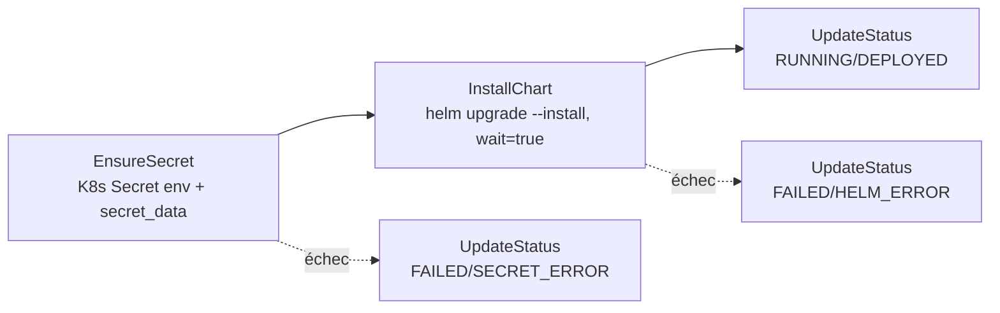
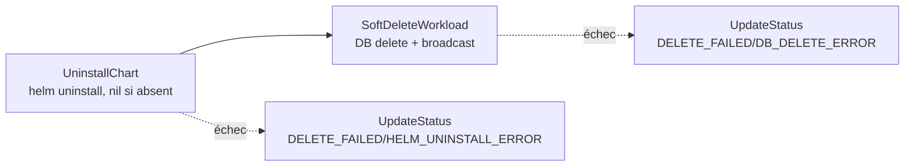

# Module `workloads`

> Lifecycle complet d'une application containerisée : deploy, scale, restart, rollback, logs, events, metrics, delete. Le cœur métier de la plateforme.

## Responsabilités

- 12 endpoints HTTP couvrant CRUD + lifecycle K8s + observabilité.
- Deploy : quota check → DB row → saga `DeployWorkloadWorkflow` (EnsureSecret → InstallChart).
- Delete : saga `DeleteWorkloadWorkflow` (UninstallChart → SoftDeleteWorkload).
- Lifecycle direct (stop/start/restart/rollback) — appels K8s synchrones, sans Temporal.
- Observabilité : LiveStatus, Logs stream, Events, Metrics live.

## Endpoints HTTP

Sous `/kmanager/v1/workloads`. Voir [route.go:136-159](../../internal/infrastructure/router/route.go#L136).

### CRUD

| Méthode | Chemin | Description |
|---------|--------|-------------|
| `POST` | `/` | Déployer (saga) |
| `GET` | `/` | Lister par projet (`?project_id=...`) |
| `GET` | `/:id` | Détails DB |
| `PATCH` | `/:id` | Update image/env/storage (helm upgrade) |
| `DELETE` | `/:id` | Supprimer (saga) |

### Lifecycle K8s (direct, pas de saga)

| Méthode | Chemin | Description |
|---------|--------|-------------|
| `POST` | `/:id/stop` | Scale to 0 (cron : `suspend: true`) |
| `POST` | `/:id/start` | Scale back to N (cron : `suspend: false`) |
| `POST` | `/:id/restart` | Rollout restart (cron : exécution immédiate, Job créé depuis le CronJob) |
| `POST` | `/:id/rollback` | Helm rollback |

### Observabilité

| Méthode | Chemin | Description |
|---------|--------|-------------|
| `GET` | `/:id/status` | LiveStatus (DB + runtime K8s) |
| `GET` | `/:id/events` | Events K8s filtrés |
| `GET` | `/:id/logs` | Stream logs pod (chunked HTTP) |
| `GET` | `/:id/metrics` | CPU/RAM live (metrics-server) + réservé (DB) |

## Sortes de conteneur (`kind`)

Colonne `workloads.kind` (migration 000028), **immuable** après la création. Règles dans [domain/kind.go](../../internal/modules/workloads/domain/kind.go) (`NormalizeProcess`).

| Sorte | Objet K8s | Port / Service / Ingress / sondes HTTP | Notes |
|-------|-----------|----------------------------------------|-------|
| `web` (défaut) | Deployment | oui (port 8080 par défaut) | domaines personnalisés possibles |
| `worker` | Deployment | non | processus continu (file d'attente, bot) |
| `cron` | CronJob | non | `schedule` obligatoire, `time_zone` IANA, `max_duration_seconds` (défaut 3600, ≤ 86400) ; 1 réplique, ni HPA ni PDB |

- `command` / `args` remplacent l'ENTRYPOINT / le CMD de l'image (toutes sortes) : même image pour le web, le worker et le cron.
- Chart : le gabarit de pod est commun (`_pod.tpl`) ; `deployment.yaml` hors cron, `cronjob.yaml` pour le cron (`concurrencyPolicy: Forbid`, `backoffLimit: 0`, `restartPolicy: Never`, `ttlSecondsAfterFinished` 1 j). `suspend` est rendu depuis le statut (STOPPED) : une mise à jour ne réactive pas un cron arrêté.
- Cron, côté service ([service/cron.go](../../internal/modules/workloads/service/cron.go)) : `LiveStatus.cron` (horaire, suspendu, exécutions en cours, dernière exécution, dernier succès) ; les journaux montrent le pod le plus récent ; `revisionBehind` lit l'annotation `checksum/env` du gabarit du CronJob.
- Surveillance des crons ([service/recover.go](../../internal/modules/workloads/service/recover.go), `SweepCrons`, chaque minute) : un cron RUNNING dont le **dernier Job** (planifié ou manuel, même image que le conteneur) est `Failed` passe `RUN_FAILED`, phase `POD_<raison>` (`BackoffLimitExceeded`, `DeadlineExceeded`…), avec alerte email aux owners. Le watcher ne peut pas le signaler : un Job échoué ne laisse qu'un pod terminé. Le Recoverer remet RUNNING dès que le dernier Job réussit. Un Job d'une image précédente est ignoré (un redéploiement ne réveille pas un ancien échec).
- RBAC de l'API : `batch/cronjobs` (deploy/k8s/rbac.yaml).
- Clients : CLI `--kind --command --schedule --timezone --max-duration`, `betorun workloads run <nom>` ; `betorun.yaml` (`kind`, `command`, `args`, `schedule`, `timezone`, `max_duration`) ; MCP `deploy` (`kind`, `command`, `schedule`, `time_zone`) ; Copilot `create_workload`.

## Réseau privé du projet

Les conteneurs d'un même projet se joignent directement ([network-policy.yaml](../../internal/infrastructure/helm/charts/standard-app/templates/network-policy.yaml), `networkPolicy.projectNetwork`) : une règle d'entrée et une règle de sortie (la sortie Internet exclut les adresses privées) vers les pods du même espace portant `app.kubernetes.io/part-of: kubemanager` et le même `km-project-id`, tous ports. Un autre projet est dans un autre espace : jamais visé. Sans identifiant de projet, aucune règle (un label vide viserait tout).

Adresse interne d'un conteneur web : `http://<nom>.<espace>.svc` (Service, port 80), renvoyée par `LiveStatus.internal_url` et affichée par la CLI et la console. Worker et cron n'en ont pas. Un conteneur existant reçoit les règles à son prochain déploiement.

## Domaines personnalisés

Un domaine se prouve par un TXT `_betorun-challenge.<nom>` propre à la demande, puis pointe vers la plateforme (A, CNAME ou ALIAS). Rien n'est routé avant la preuve ([service/domains.go](../../internal/modules/workloads/service/domains.go)).

- **Chemin** (migration 000029) : une route = nom + chemin (`/` par défaut). Plusieurs conteneurs d'un même projet partagent un nom, un chemin chacun (ex. `/auth` vers Keycloak, `/` vers le site) ; Traefik sert la règle la plus longue. Une route vérifiée n'a qu'un conteneur (`UNIQUE (hostname, path) WHERE verified`). Un nom déjà prouvé dans le projet transmet sa preuve aux nouveaux chemins. Un autre projet garde le nom tant que sa preuve est en place ; sinon toutes ses routes tombent (changement de mains). L'application doit savoir servir sous son préfixe (pas de réécriture).
- **Enregistrements** : chaque enregistrement porte `name` (complet) et `host` (relatif à la zone, `@` au sommet ; zone = domaine enregistré, liste des suffixes publics). Sous-domaine : CNAME si la cible (`kubernetes.ingress_target`) est un nom, A si c'est une IP. Domaine nu : A vers les adresses IPv4 de la cible, plus un ALIAS proposé `alternative` (le fournisseur suit alors un changement d'adresse). Recommandé : une cible par nom, pour qu'un changement d'IP ne demande rien aux clients en sous-domaine.
- **Fournisseur DNS** : reconnu par les serveurs NS de la zone (`dns_provider` : cloudflare, ovh, godaddy, namecheap, gandi, google, route53, ionos, hostinger, lws…) ; la console et la CLI affichent le guide correspondant.
- Chart : un Ingress et un certificat par route (`customDomains` = `{host, path}`) ; une route `/` garde le nom d'Ingress d'avant les chemins.

## Table DB

| Table | Rôle |
|-------|------|
| `workloads` | project_id, name, namespace, chart, version, image, kind, status, phase, replicas, resources, network, storage, labels |

## Activities Temporal

### `DeployWorkloadWorkflow`

Fichier : [workloads/workflows/deployWorkload.go](../../internal/modules/workloads/workflows/deployWorkload.go).



**Compensation** : pas de rollback automatique. Le workload reste en DB avec `status=FAILED` — l'utilisateur fait un DELETE ou retry manuel.

### `DeleteWorkloadWorkflow`

Fichier : [workloads/workflows/deleteWorkload.go](../../internal/modules/workloads/workflows/deleteWorkload.go).



Design **"Helm first, DB second"** — minimise les orphelins K8s si la DB échoue (vaut mieux avoir une row en DELETE_FAILED qu'une release Helm orpheline dans K8s).

## Invariants critiques

1. **Saga Delete : Helm uninstall AVANT soft-delete DB**. Inverser = risque d'orphelin K8s.
2. **Idempotence** : `InstallChart` et `UninstallChart` passent par `idempotency.ExecuteActivity()` (TTL 10 min).
3. **Isolation** : namespaces préfixés `km-<project-id>`, jamais cross-project.
4. **Retry** : `UninstallChart` max 3x, timeout 5 min ; nil si release absente (safe retry).
5. **Publisher fail-open** : si Centrifugo plante, le broadcast est silencieusement dropped — ne casse jamais la saga.
6. **Port 8080 est réservé** côté kubemanager lui-même. Un workload qui demande `target_port: 8080` est rejeté au niveau service.
7. **Quota checks** avant `Create(workload)` — somme `CPULimit × Replicas` de tous les workloads actifs du projet, ne doit pas dépasser `project.CpuLimit`.

## Status DB possibles

```
PENDING → DEPLOYING → RUNNING | FAILED
                          ↓
                    SCALING_UP / SCALING_DOWN
                    RESTARTING / UPDATING / ROLLING_BACK
                    STOPPED
                          ↓
                    DELETING → DELETED | DELETE_FAILED
```

## Pitfalls

- **Logs stream deadlock** — le handler `GetWorkloadLogs` écrit directement sur `c.Writer` via `io.Copy`. Si le client ferme la connexion, le stream doit fermer proprement. Aujourd'hui on utilise `wrapRawHandler` qui bypass tonic — ne pas essayer de le passer en tonic, ça casserait le streaming.
- **Orphan workload après delete project** — si un workload est créé pendant un delete project, il peut survivre. Voir pitfalls de [projects](projects.md).
- **quota stale** — le `GetTotalUsageByProject` lit la DB, pas le runtime K8s. Si un workload est `STOPPED` (0 replicas), il compte quand même dans le quota (sa `replicas` initiale est en DB). À valider si on veut changer ce comportement.

## Tests

- [service/lifecycle_test.go](../../internal/modules/workloads/service/lifecycle_test.go) — Delete happy/not-found, Deploy quota CPU/Memory, project not-found.
- [activities/db_test.go](../../internal/modules/workloads/activities/db_test.go) — UpdateWorkloadStatus (publisher fail-open, DB fail, nil publisher), SoftDeleteWorkload.
- [workflows/deleteWorkload_test.go](../../internal/modules/workloads/workflows/deleteWorkload_test.go) — saga happy, Helm uninstall fail, soft-delete fail.

## Fichiers clés

- [domain/entity.go](../../internal/modules/workloads/domain/entity.go), [domain/dto.go](../../internal/modules/workloads/domain/dto.go) — modèle + DTOs.
- [repository/repo.go](../../internal/modules/workloads/repository/repo.go) — WorkloadRepository.
- [service/deploy.go](../../internal/modules/workloads/service/deploy.go) — Deploy, Update, parseurs CPU/mem.
- [service/lifecycle.go](../../internal/modules/workloads/service/lifecycle.go) — Get, List, Delete, Stop/Start/Restart/Rollback, LiveStatus, Logs, Events, Metrics.
- [service/interface.go](../../internal/modules/workloads/service/interface.go) — IWorkloadService (contrat complet).
- [activities/heml.go](../../internal/modules/workloads/activities/heml.go) — InstallChart, UninstallChart, EnsureSecret (noter le typo "heml" historique).
- [activities/db.go](../../internal/modules/workloads/activities/db.go) — UpdateWorkloadStatus, SoftDeleteWorkload, broadcast Centrifugo.
- [workloads.go](../../internal/modules/workloads/workloads.go) — controller.

## Points d'attention ajout de feature

- Nouveau lifecycle (ex: "pause") → décider s'il passe par Temporal (si effet DB ou plusieurs systèmes) ou en direct (si 1 appel K8s atomique).
- Nouveau champ DTO → ajouter dans `CreateWorkloadRequest`, propager dans `DeployWorkloadInput`, transformer en values Helm dans `heml.go:buildValues`.
- Changer le chart `standard-app` → c'est le chart partagé par tous les workloads. Tester en staging d'abord avec un workload sacrificiel.
