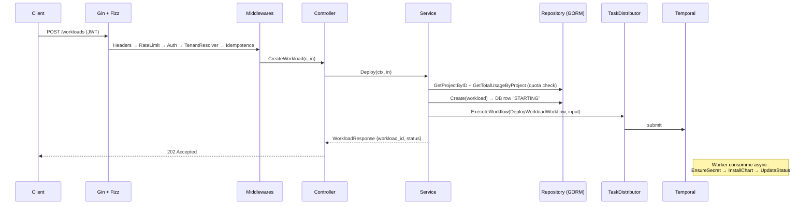

# Tour du code (45 min)

> Objectif : après cette lecture, tu sais où chercher quand on te dit "regarde le middleware auth" ou "le workflow de delete workload".

## La règle d'or

Une directive importée partout : **un fichier = une responsabilité**. Si tu cherches *quelque chose*, tu peux le trouver en lisant les noms de dossiers d'abord, les noms de fichiers ensuite.

## Arbre commenté

```
kubemanager/
├── cmd/
│   ├── gateway/           # entry-point binaire (main.go)
│   │                        APP_MODE=server → serveur HTTP
│   │                        APP_MODE=worker → worker Temporal
│   └── dev-docs/          # générateur du devportal (go run ./cmd/dev-docs)
│
├── internal/
│   ├── core/              # primitives partagées (pas d'import métier ici)
│   │   ├── cache/           Redis client + wrappers
│   │   ├── configs/         struct GlobalConfig (toute la config env)
│   │   └── workerpool/      pool goroutines bornées (async DB writes)
│   │
│   ├── infrastructure/    # adapters vers le monde extérieur
│   │   ├── database/        ouverture GORM + plugin OTEL
│   │   ├── helm/            chart standard-app + wrapper SDK
│   │   ├── idempotence/     Begin/Complete/Fail Redis (saga idempotence)
│   │   ├── keycloak/        client Keycloak (admin REST + token endpoint)
│   │   ├── kubernetes/      K8s client + resolver kubeconfig par cluster
│   │   ├── observability/   metrics business + MetricsHandler Temporal
│   │   ├── realtime/        Publisher Centrifugo + TokenSigner HS256
│   │   ├── router/          DI (App struct), server HTTP, workflow routes
│   │   └── temporal/        Distributor + Processor worker Temporal
│   │
│   ├── middleware/        # middlewares Gin (auth, rate limit, idempotence…)
│   │   ├── security/        AuthMiddleware (JWT Bearer + API key)
│   │   ├── apikey_auth.go
│   │   ├── audit.go         logs d'audit structurés
│   │   ├── headers.go       SecureHeaders CORS/CSP
│   │   ├── idempotence.go   scope key par userID
│   │   ├── rateLimit.go     token bucket Redis
│   │   ├── tenant_resolver.go
│   │   └── verifierjwt.go   vérif JWT avec JWKS
│   │
│   └── modules/           # domaine métier (1 dossier = 1 module)
│       ├── auth/            users, sessions, API keys, RBAC
│       ├── identity/        bootstrap Keycloak (register/login/refresh/OAuth)
│       ├── projects/        provisioning namespace K8s + saga
│       ├── workloads/       lifecycle complet (deploy, scale, delete)
│       ├── clusters/        enroll watcher + onPodEvent
│       ├── realtime/        /realtime/token + subscription
│       └── utils/           helpers transverses (validation, etc.)
│
├── chart/
│   ├── kubemanager-backend/   chart Helm pour déployer le backend
│   └── (standard-app vit dans internal/infrastructure/helm/charts/)
│
├── docker/                # configs docker-compose (promtail, loki, grafana, prometheus)
├── migrations/            # SQL golang-migrate (000001_init.up.sql, down)
├── scripts/               # helpers shell (keycloak, e2e, loadtest)
├── loadtest/              # scénarios k6
└── docs/                  # cette doc, devportal, interne
```

## Convention par module

Chaque `internal/modules/<name>/` suit la même structure :

```
<name>/
├── h<name>.go             # controller tonic/fizz (entrypoint HTTP)
├── domain/                # DTOs + entities GORM (struct tags `gorm:`)
├── repository/            # accès DB (interface + implémentation pgRepo)
├── service/               # logique métier (orchestration repos + activities)
├── activities/            # Temporal activities (effets K8s/Helm)
└── workflows/             # Temporal workflows (saga + compensation)
```

**Règle** : jamais d'import d'un module à un autre niveau `service/`. Si `workloads/service` a besoin de `projects/repository`, OK ; s'il a besoin de `projects/service`, c'est que la frontière est fausse — remonter dans une couche partagée.

## Trouver une route

Toutes les routes sont déclarées dans [internal/infrastructure/router/route.go](../../internal/infrastructure/router/route.go). Recherche par chemin :

```sh
grep -n 'POST.*workloads\|/workloads' internal/infrastructure/router/route.go
```

Chaque route fait :

```go
WorkloadGroup.AddRoute("/:id/stop", http.MethodPost,
    "Stop (scale to 0)",
    tonic.Handler(r.StopWorkload, http.StatusOK))
```

→ `r.StopWorkload` est une méthode sur le controller (`hworkloads.go`) qui appelle le service.

## Flow typique d'une requête



## Le pattern saga

Pour chaque action critique qui touche du K8s :

1. Le service valide + pose la DB row "PENDING/STARTING".
2. Il démarre un workflow Temporal via `TaskDistributor.ExecuteWorkflow`.
3. Le workflow enchaîne des activités idempotentes (`activities/*.go`).
4. Chaque activité qui touche du K8s passe par `idempotency.ExecuteActivity()` (TTL 10 min) pour éviter les effets doubles sur retry.
5. En cas d'échec, le workflow déclenche la compensation (supprime la DB row, ou marque FAILED).

Voir [architecture/temporal-sagas.md](../architecture/temporal-sagas.md) pour les détails.

## Le pattern DI

Tout est construit dans [internal/infrastructure/router/dependencies.go](../../internal/infrastructure/router/dependencies.go). Ordre :

```
initTracing → initDatabase → initCache → initTemporalClient → initKubernetes
→ initSecurity → initRepos → initServices → initControllers
```

L'`App` struct porte tous les singletons (DB, Redis, Temporal client, K8s client, Publisher, TokenSigner, etc.). Tu ne dois **jamais** créer ces singletons ailleurs — demande l'`App` (ou une sous-struct) en paramètre.

## Le pattern tonic/fizz

Nos controllers ne parsent pas les requêtes manuellement. On utilise [loopfz/gadgeto/tonic](https://github.com/loopfz/gadgeto) :

```go
func (h *WorkloadController) CreateWorkload(c *gin.Context, in *domain.CreateWorkloadRequest) (*domain.WorkloadResponse, error)
```

- Tonic parse le `*domain.CreateWorkloadRequest` depuis le body (`json:` tags), les path params (`path:` tags), les query (`query:` tags).
- Retourne `(response, error)` : fizz sérialise automatiquement + applique le status code passé à `AddRoute`.

Pour les endpoints qui streament (logs), on bypass tonic via `wrapRawHandler` dans [wrapper.go](../../internal/infrastructure/router/wrapper.go).

## Les patterns transverses à connaître

1. **Isolation tenant** : toute query filtre par `project_id`. Jamais de `SELECT * FROM workloads` sans where.
2. **Idempotence HTTP** : header `Idempotency-Key` + scope `userID + method + path` dans Redis — protège les POST critiques.
3. **Publisher fail-open** : Centrifugo peut planter, ça ne casse pas la saga. Erreur loggée, pas remontée.
4. **Trace ID** : posé par le middleware OTEL, récupérable dans un handler via `middleware.LoggerFrom(c, a.Logger)`.
5. **Context propagation** : `ctx` passé partout (même les repos), OBLIGATOIRE pour que OTEL / timeouts / annulations marchent.

## Prochaine étape

→ [Glossaire](04-glossaire.md)
